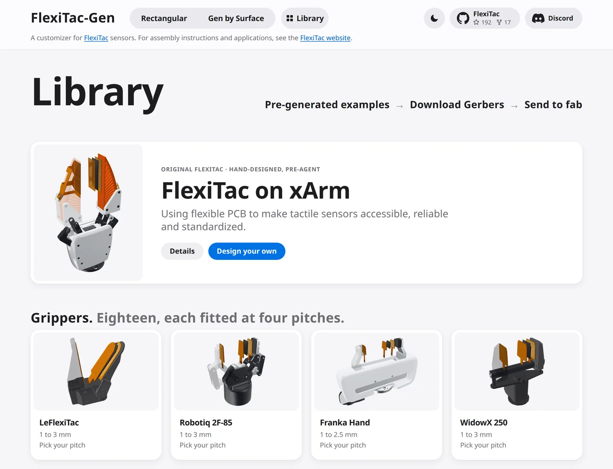
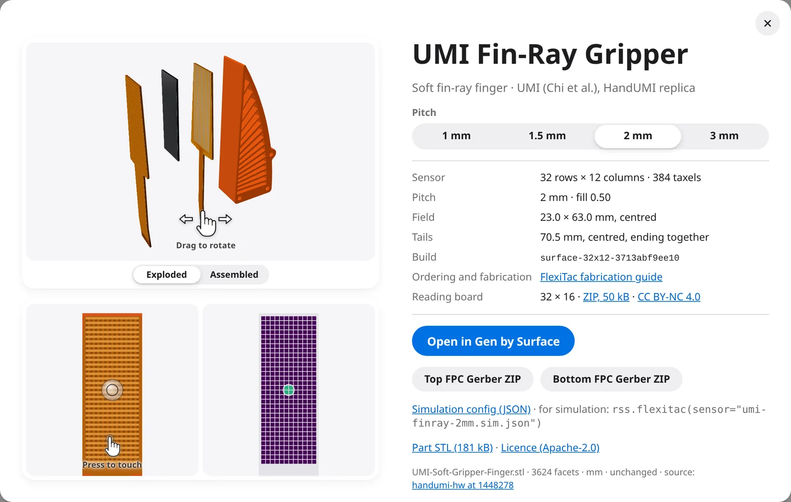
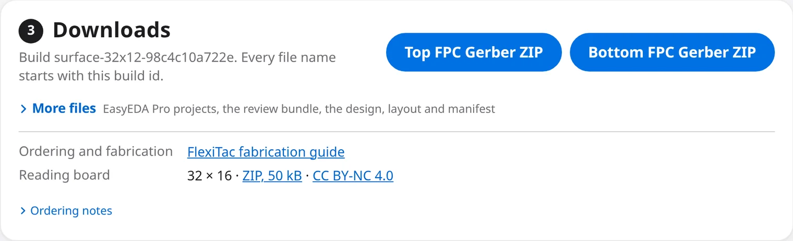
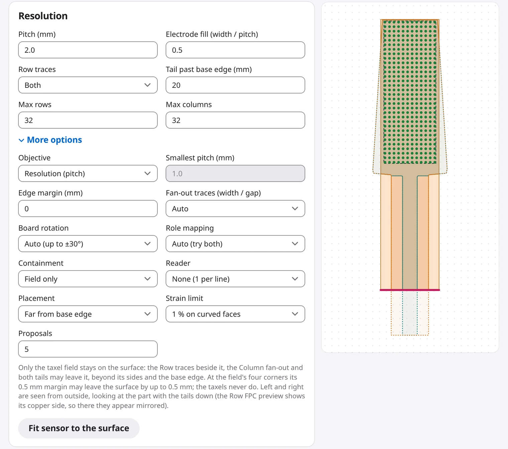
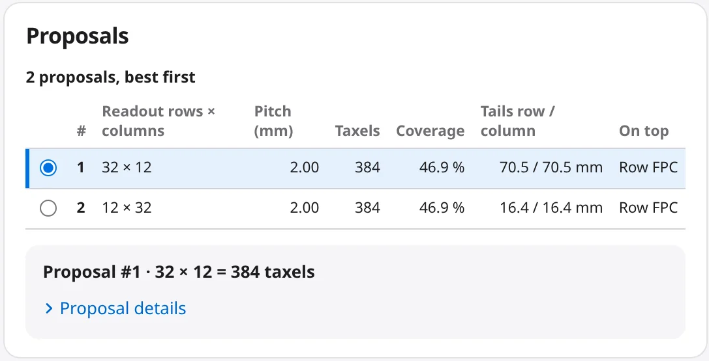

[FlexiTac-Gen](/flexitac-gen/) generates the two FPCs of a FlexiTac sensor for a gripper, fingertip or hand other than the standard pad. It runs entirely in your browser: your 3D model is never uploaded. The first visit downloads about 7 MB. There are three ways in, from least to most work:

1. **[Library](#library):** a sensor already fitted to a known gripper. Pick a pitch and download.
2. **[Gen by Surface](#gen-by-surface):** load your own part, click the face and its base edge, press **Generate sensor**. The default settings do the rest.
3. **[Advanced Customization](#advanced):** set the pitch, the electrode width, the number of rows and columns and the tails yourself.

Each way ends with the same two Gerber ZIPs, which you then [order, build and read](#order) like the standard sensor.

## Start from the Library {#library}



:::steps
#### Find your gripper
Open [FlexiTac-Gen](/flexitac-gen/). The Library comes first. The top card is the original, hand-designed FlexiTac on the xArm gripper. Below it are 18 grippers and hands (LeFlexiTac, Robotiq 2F-85, Franka Hand, WidowX 250 and more), each fitted at four pitches, and the UMI fin-ray finger in six shapes, from straight to pointed.

#### Pick a pitch
Click a card. Its page shows the sensor on the part, which you can turn and switch between **Exploded** and **Assembled**. The **Pitch** switch gives the same finger at its other pitches. The list below gives the sensor's rows × columns and taxel count, its field and tails, and the reading board it needs.



#### Download
**Top FPC Gerber ZIP** and **Bottom FPC Gerber ZIP** are the two boards to order. **Reading board** links the board's own ZIP. **Part STL** is the finger the sensor was fitted to.
:::

:::tip[Almost right?]
**Open in Gen by Surface** loads that sensor into the generator, already built, so you can change it from there with [Advanced Customization](#advanced).
:::

## Fit a sensor to your own part {#gen-by-surface}

Switch to **Gen by Surface** in the header, or press **Design your own** in the Library. The guide on the left has three steps: **Load your gripper**, **Generate the sensor**, **Send to manufacture**. The example here is the part it opens with, the UMI soft gripper finger.

:::steps
#### Load your part
Gen by Surface opens with the UMI finger already loaded and its sensor already built. To follow along on it, press **Clear** in the tools on the left of the 3D view. For your own gripper, press **Choose File** or drag an STL onto the 3D view. **File details** shows the unit it was read in, which should be millimetres. **Try a sample** has eight more parts to practice on.

#### Click the face the sensor goes on
With **Select a surface** (tool 1, left of the 3D view), click the finger's flat contact face. It turns orange. Flat, creased and singly curved faces work, such as cylinders, cones and extrusions. On a doubly curved face, such as a fingertip's dome, the click selects the largest patch a flat sheet can cover with less than 1 % stretch.

#### Select the base edge
The base edge is the edge both tails leave the sensor across, on their way to the reading board. Choose **Base edge** (tool 2) and click the gripper's bottom edge: on the UMI finger, the short edge at the mounting end, by the screw holes. It turns red. Choose it yourself: before the fit, **Auto** marks a long side. You can also pick the edge from the list under **Advanced Customization → Base edge**, here **Side 0 · 25.8 mm**.

 and its base edge at the finger's mounting end (red).")

#### Press Generate sensor
The defaults are set for a FlexiTac sensor:

- 2.0 mm pitch, with electrodes half the pitch wide.
- At most 32 rows and 32 columns.
- Taxels that fill the face's own shape, not only a rectangle.
- Both tails leaving across the base edge and ending together 20 mm past it.

After a few seconds the sensor appears on the part, together with previews of both FPCs and the stacked sensor. Turn it, or switch between **Exploded** and **Assembled**. On the UMI finger the defaults give **32 rows × 12 columns = 384 taxels** at 2.0 mm, at the fingertip: the same grid as the standard sensor.

 and on the finger (right).")

#### Check and download
**Design checks** must read "all checks pass". The downloads are blocked until they do. Then **Downloads** gives the **Top FPC Gerber ZIP** and the **Bottom FPC Gerber ZIP**, and names the reading board your sensor needs.


:::

## Advanced Customization {#advanced}

Open **Advanced Customization** under **Generate sensor** to set the design yourself. Change the settings, press **Fit sensor to the surface**, pick one of the proposals, then press **Generate & validate**.



**Base edge**, at the top of the panel, lists the same edges the **Base edge** tool picks from, with their lengths. **Edit border** (optional, in the tools on the left of the 3D view) lets you drag the outline the taxels must stay inside.

Under **Resolution**:

| Setting | Default | What it changes |
| --- | --- | --- |
| **Pitch (mm)** | 2.0 (0.6–10) | Distance between taxels. A smaller pitch gives more taxels and finer resolution. |
| **Electrode fill (width / pitch)** | 0.5 (0.05–0.95) | How wide each electrode is, as a fraction of the pitch. |
| **Max rows**, **Max columns** | 32 each (1–64) | The largest grid the fit may use. |
| **Row traces** | Both | The side of the field the row traces run down: **Both** (alternate sides, the narrowest tip), **Left**, **Right**, or **Straight channel**. |
| **Tail past base edge (mm)** | 20 (6.5–72.5) | How far past the base edge the tails end. |

Under **More options**:

| Setting | Default | What it changes |
| --- | --- | --- |
| **Objective** | Resolution (pitch) | **Resolution** fits the most taxels at your pitch. **Most taxels** may go down to **Smallest pitch**. **Largest sensing area** grows the field instead. |
| **Edge margin (mm)** | 0 | Keeps the boards this far from the face's edge. |
| **Fan-out traces (width / gap)** | Auto | 0.127 / 0.127 mm, or the 0.1016 / 0.1016 mm minimum for crowded designs. |
| **Board rotation** | Auto (up to ±30°) | Lets the boards turn against the base edge when that fits more taxels. |
| **Role mapping** | Auto (try both) | Which FPC lies on top. |
| **Containment** | Field only | **Field only**: only the taxels must lie on the face, while traces and tails may run past its edges. **Whole board**: everything down to the tails stays on the face. |
| **Reader** | None (1 per line) | Sizes the tails for a reading board's connectors, such as **32 × 16 (FlexiTac)**. |
| **Placement** | Far from base edge | Where the field sits on the face when it doesn't fill it. |
| **Strain limit** | 1 % on curved faces | How much stretch is allowed on a doubly curved face. **Strict 0.3 %** allows less. |
| **Proposals** | 5 | How many layouts the fit returns. |

**Fit sensor to the surface** lists its proposals, best first, up to the number set in **Proposals**. Each has its rows × columns, pitch, taxel count, how much of the face it covers and its tail lengths. Choose one and press **Generate & validate**.



:::tip[A flat, rectangular pad?]
Use **Rectangular** in the header instead. You type the rows, columns and pitch directly, and the same options sit under its own Advanced Customization.
:::

## Order, build and read it {#order}

:::steps
#### Order the FPCs
Upload each Gerber ZIP as in [Order the FPCs](/doc/get-started/order-parts/#order-the-fpcs). Each ZIP carries an `ORDER_NOTES.txt` with the settings it needs: a 0.2 mm flexible board, gold fingers 0.3 mm thick, and a polyimide stiffener under them.

#### Get the reading board it names
FlexiTac-Gen names the board your sensor needs. The **32 × 16** board takes up to 32 lines on one FPC and 16 on the other, which covers most single-finger sensors. The **32 × 32** board takes up to 32 on each. Both boards' files and how to choose between them are in [Which reading board?](/doc/get-started/order-parts/#which-board)

#### Fabricate it
Laminate, stack and seal it exactly as in [Fabricate a sensor](/doc/get-started/fabricate/). Insert each tail's gold fingers straight and [against one side](/doc/get-started/troubleshooting/#short) of its FFC extender.

#### Flash and stream it
The firmware's **rows** are the lines on the board's 16-pin connector and its **columns** are those on the 32-pin connector, whatever FlexiTac-Gen calls them. A 32-row × 12-column Gen sensor is read as 12 × 32. Flash and read it with that size and its multiplexer offset, as in [Match the reader to the firmware](/doc/get-started/pyflexitac/#rows).
:::

:::caution[Generated sensors fold their row pins]
With **Row traces: Both**, the default and what every Library sensor uses, the row traces alternate sides. So the Row FPC's pins don't carry rows 1, 2, 3… in order but 1, 3, 5, … 6, 4, 2. The Row FPC ZIP's `ORDER_NOTES.txt` lists the row on every pin. Put that axis of the frame back in order in your code:

```python title="unfold.py"
import numpy as np

# From ORDER_NOTES.txt: the row on pin 1, 2, 3, … (32 rows here)
pin_rows = [1, 3, 5, 7, 9, 11, 13, 15,
            17, 19, 21, 23, 25, 27, 29, 31,
            32, 30, 28, 26, 24, 22, 20, 18,
            16, 14, 12, 10, 8, 6, 4, 2]
order = np.argsort(pin_rows)   # the pin of row 1, 2, 3, …

# Here the Row FPC's 32 lines are the frame's columns
raw = frame.raw[:, order]
```

Then press once per row, from one end to the other: the bright spot should move one row at a time. On a sensor whose field isn't a full rectangle, the grid positions without a taxel always read 0.
:::

## Next {#next}

:::cards
#### Order parts | /doc/get-started/order-parts/ | cart
The ordering settings for the FPCs, the reading board and the parts list.

#### Fabricate a sensor | /doc/get-started/fabricate/ | layers
Laminate, stack and seal the two FPCs around the Velostat.

#### Troubleshooting | /doc/get-started/troubleshooting/ | lifebuoy
Dead rows, a scrambled picture or no frames, by symptom.
:::
