Fabricating a FlexiTac-V2 sensor is mostly lamination: no soldering, and no special tools beyond scissors or a craft knife. Once you have done it once, a sensor takes under three minutes.

:::tip[Watch it first]
The steps below follow the [fabrication video](https://www.youtube.com/watch?v=HYmMbsrwWFA). It's worth watching once before your first build.
:::

## Materials

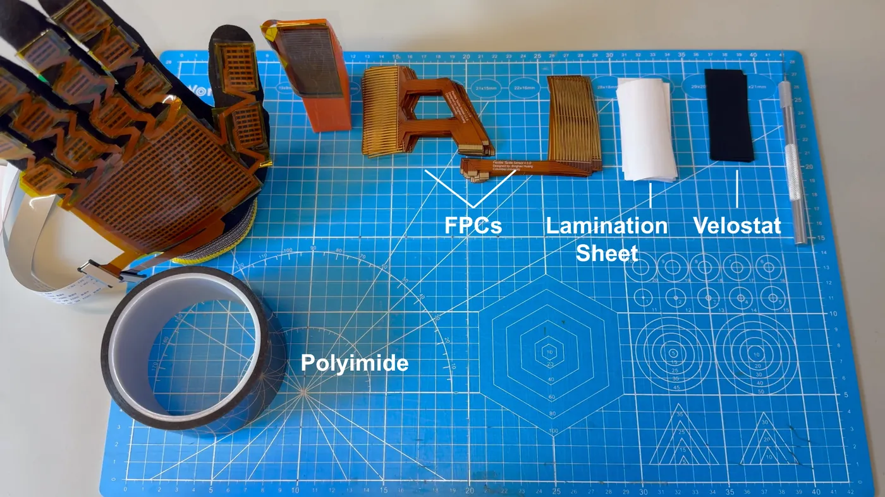

| Item | BOM # | Notes |
| --- | ---: | --- |
| Top FPC and bottom FPC | 1 | One of each per sensor |
| Adhesive laminating sheets | 4 | Two pre-cut pieces, one per FPC |
| Velostat / Linqstat | 3 | One piece that covers the electrode area |
| Polyimide tape | 2 | For sealing the edges |
| FFC extenders (16- and 32-pin) and flat cables | 7–12 | For connecting to the reading board in step 4 |
| Assembled reading board | 5–6 | Flashed or not; you can flash it later |

See [Order parts](/doc/get-started/order-parts/#bom) for the full bill of materials.

## How the layers stack {#stack}

A FlexiTac sensor is five thin layers. Both FPCs turn their copper electrodes toward the Velostat in the middle: the top FPC's 12 columns face down and the bottom FPC's 32 rows face up. Wherever a row crosses a column there is a taxel, and pressing it squeezes the film between the two electrodes.

<figure class="figure exploded" id="stack-figure">

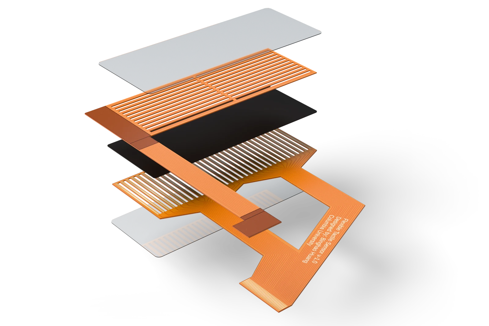
<svg class="xlines" viewBox="0 0 1600 1067" preserveAspectRatio="none" aria-hidden="true"><line x1="98" y1="154" x2="316" y2="208"/><circle cx="316" cy="208" r="5"/><line x1="98" y1="310" x2="271" y2="371"/><circle cx="271" cy="371" r="5"/><line x1="98" y1="466" x2="345" y2="476"/><circle cx="345" cy="476" r="5"/><line x1="98" y1="622" x2="361" y2="601"/><circle cx="361" cy="601" r="5"/><line x1="98" y1="778" x2="357" y2="725"/><circle cx="357" cy="725" r="5"/></svg>
1
2
3
4
5

</figure>

<ol class="layers">
<li><b>Laminating sheet</b> holds the top FPC from behind.</li>
<li><b>Top FPC</b>: 12 column electrodes, copper side down. You see its back here, with the copper showing through.</li>
<li><b>Velostat</b>: the pressure-sensitive film, cut to cover the electrode area.</li>
<li><b>Bottom FPC</b>: 32 row electrodes, copper side up.</li>
<li><b>Laminating sheet</b> holds the bottom FPC from behind.</li>
</ol>

Steps 1 and 2 below build exactly this stack: each FPC on its own laminating sheet, then the Velostat between them. Both tails leave on the same side. Step 3 then seals the edges with polyimide tape.

## Build the sensor

:::steps
#### Attach each FPC to a lamination sheet and align it
Peel a pre-cut lamination sheet and attach the **top FPC** to it. Do the same with the **bottom FPC** on a second sheet. Align the corners exactly, as in the photos: the two layers must line up when you stack them in step 2.

<figure><a class="zoom" href="/doc/assets/img/fab-step1-laminate.webp">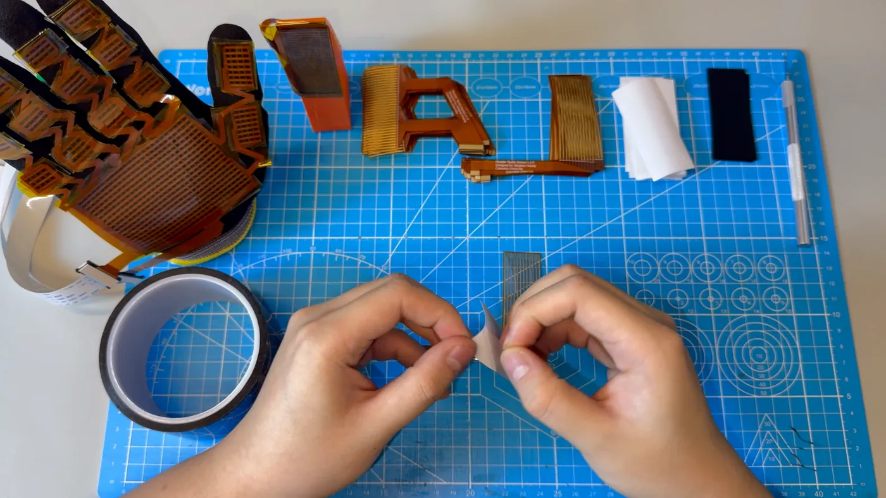</a><figcaption>Peel the lamination sheet.</figcaption></figure>
<figure><a class="zoom" href="/doc/assets/img/fab-step1-align.webp">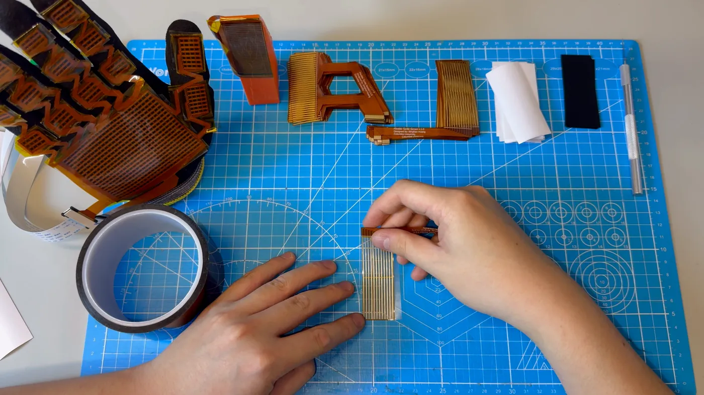</a><figcaption>Place the FPC, corners aligned.</figcaption></figure>
<figure><a class="zoom" href="/doc/assets/img/fab-step1-laminated.webp">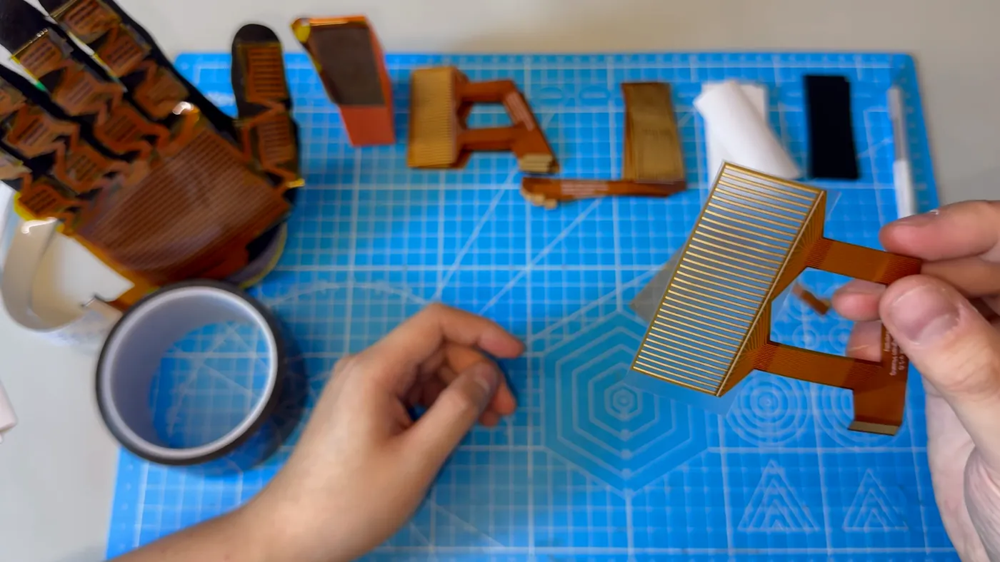</a><figcaption>One laminated FPC layer.</figcaption></figure>

#### Stack the Velostat between the two layers
Place the Velostat in the middle, between the two prepared layers, centered over the electrode area. Close the stack with the second layer. **Once it's centered, the sensor stack already works.**

<figure><a class="zoom" href="/doc/assets/img/fab-step2-velostat.webp">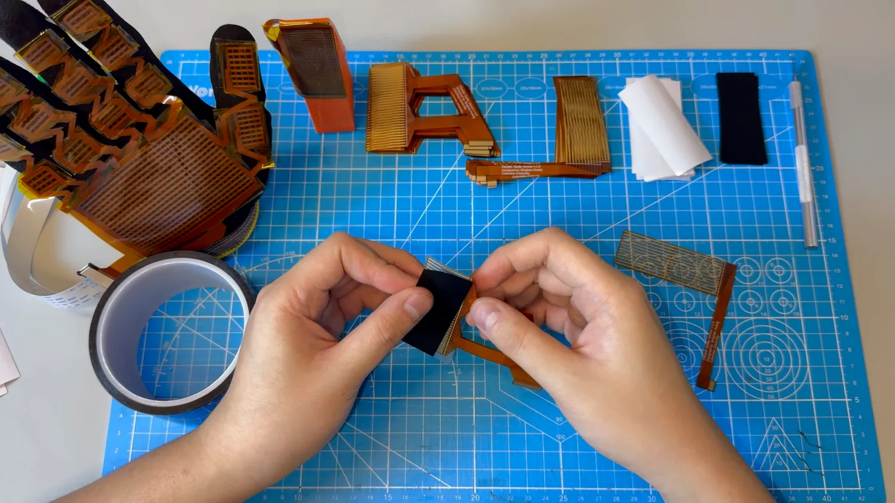</a><figcaption>Center the Velostat over the electrodes.</figcaption></figure>
<figure><a class="zoom" href="/doc/assets/img/fab-step2-close.webp">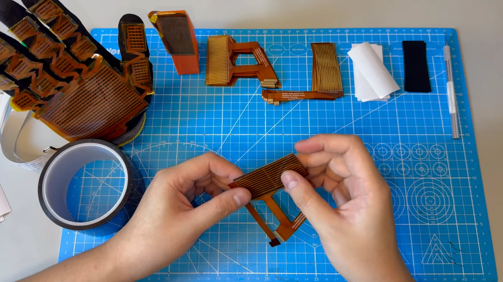</a><figcaption>Close the stack with the other layer.</figcaption></figure>

#### Seal the edges with polyimide tape
Lay out a strip of polyimide tape and seal the border of the stack. This doesn't change how the sensor works. It holds the layers in place and keeps the sensor intact through long experiments.

<figure><a class="zoom" href="/doc/assets/img/fab-step3-polyimide.webp">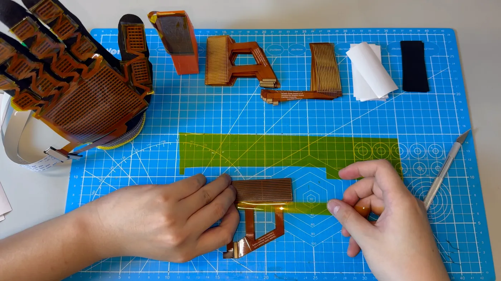</a><figcaption>Place the stack on the tape.</figcaption></figure>
<figure><a class="zoom" href="/doc/assets/img/fab-step3-sealed.webp">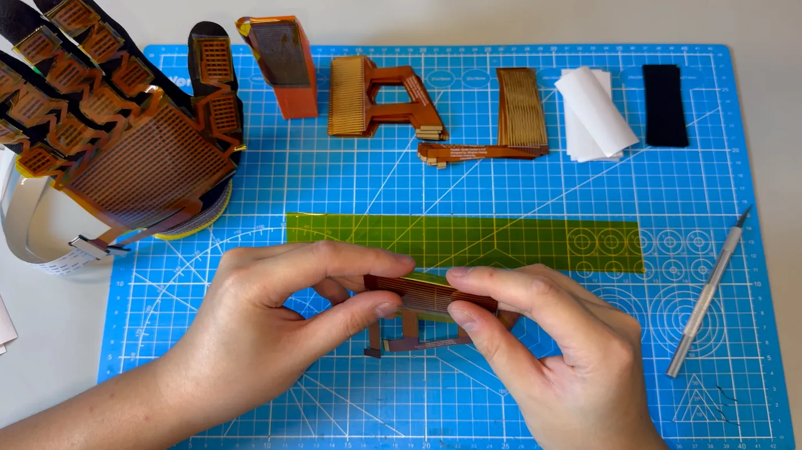</a><figcaption>Fold the tape around the edges.</figcaption></figure>

#### Connect to the reading board
Insert each sensor's **gold fingers** into an FFC connector (extender), then run a flat flexible cable from each connector to the reading board. The wider gold-finger end takes the 32-pin connector and cable, and the narrower one takes the 16-pin connector and cable.

<figure><a class="zoom" href="/doc/assets/img/fab-step4-parts.webp">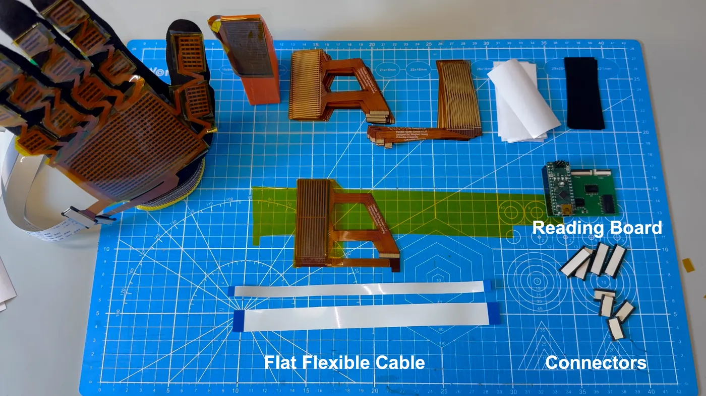</a><figcaption>Sealed sensor, reading board, flat cables and connectors.</figcaption></figure>
<figure><a class="zoom" href="/doc/assets/img/fab-step4-insert.webp">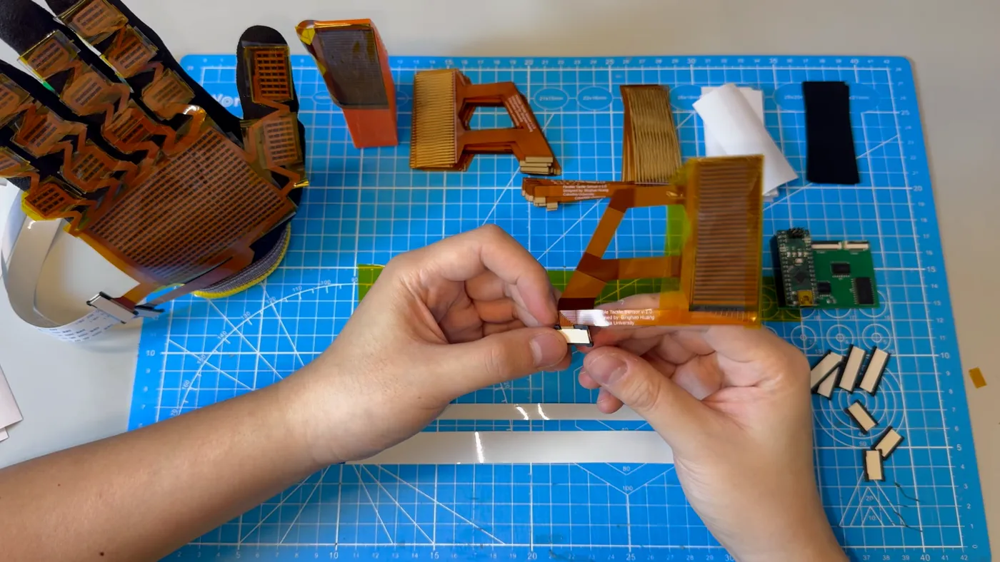</a><figcaption>Insert the gold fingers into the connector.</figcaption></figure>
<figure><a class="zoom" href="/doc/assets/img/fab-step4-cable.webp">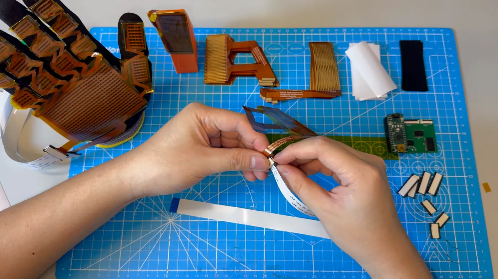</a><figcaption>Attach the flat cable.</figcaption></figure>
<figure><a class="zoom" href="/doc/assets/img/fab-step4-connected.webp">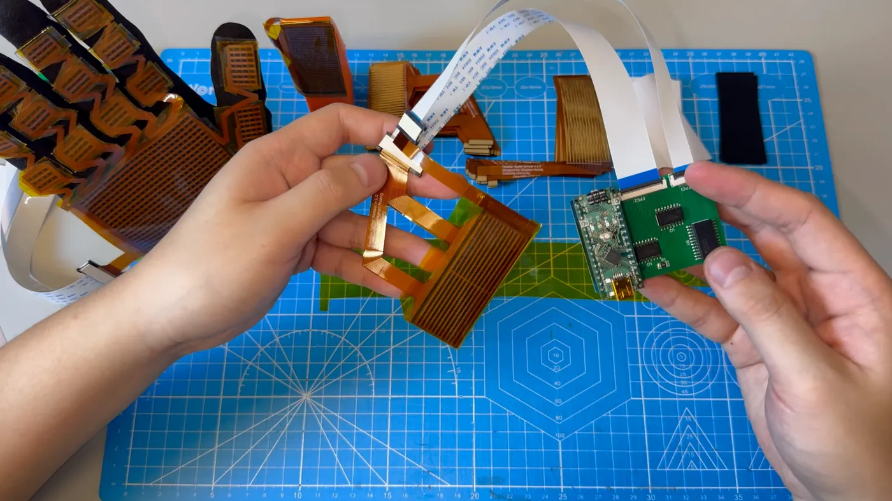</a><figcaption>Done: the sensor is connected to the reading board.</figcaption></figure>

:::

## Tips for a good sensor

- **Fully seat the gold fingers.** Push each FPC end all the way into its connector, straight and not skewed. A finger that's half-seated or off by one pin is the most common cause of dead or swapped rows.
- **Mind the cable orientation.** FFC contacts are on one side only. If a whole sensor reads nothing, check that each cable's contacts face the connector contacts at both ends.
- **The Adafruit extenders need practice.** They're compact but take careful alignment. The AliExpress extenders (BOM #12) are bulkier but easier to install.
- **Keep the Velostat covering every crossing.** Taxels outside the film won't respond. An off-center film shows up as a dead edge on the heatmap.
- **Make a few at once.** Sensors are consistent enough that spares are interchangeable, and having one makes it easy to tell a bad sensor from a bad board.

:::note[How long does a sensor last?]
In the authors' experience, sensors stay consistent for about a year of use without significant degradation. Some teams have collected thousands of demonstrations without breaking one. If a sensor is damaged, replace it. Swapping in a new sensor typically doesn't noticeably affect performance.
:::

## Next

Your sensor is wired to the reading board. Now [stream the sensor](/doc/get-started/stream/).
