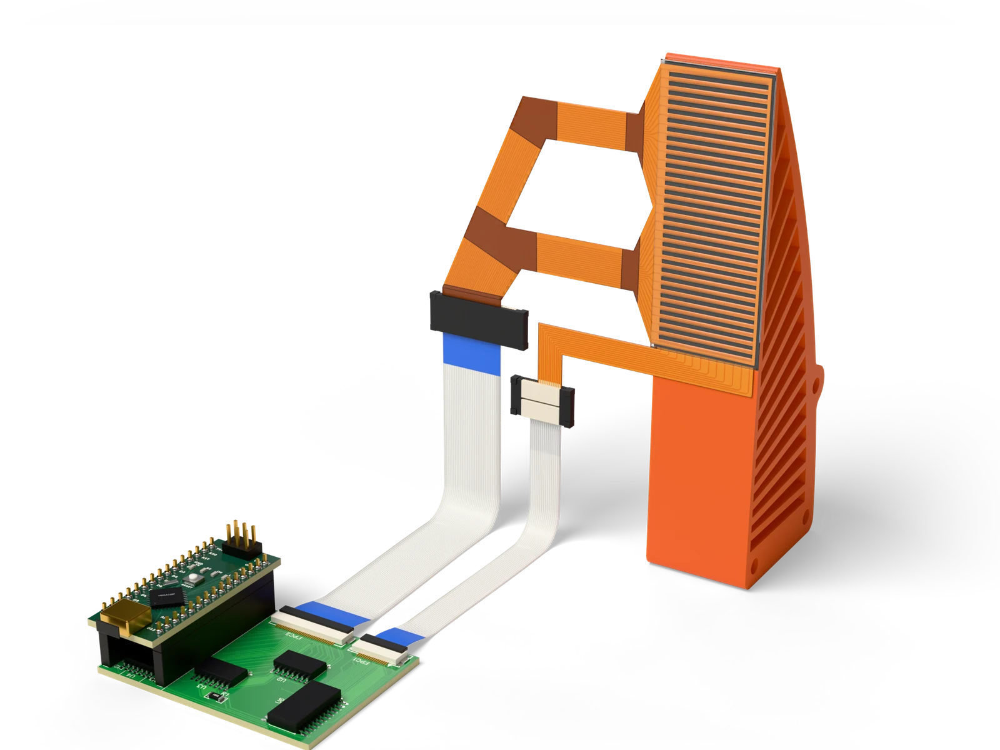
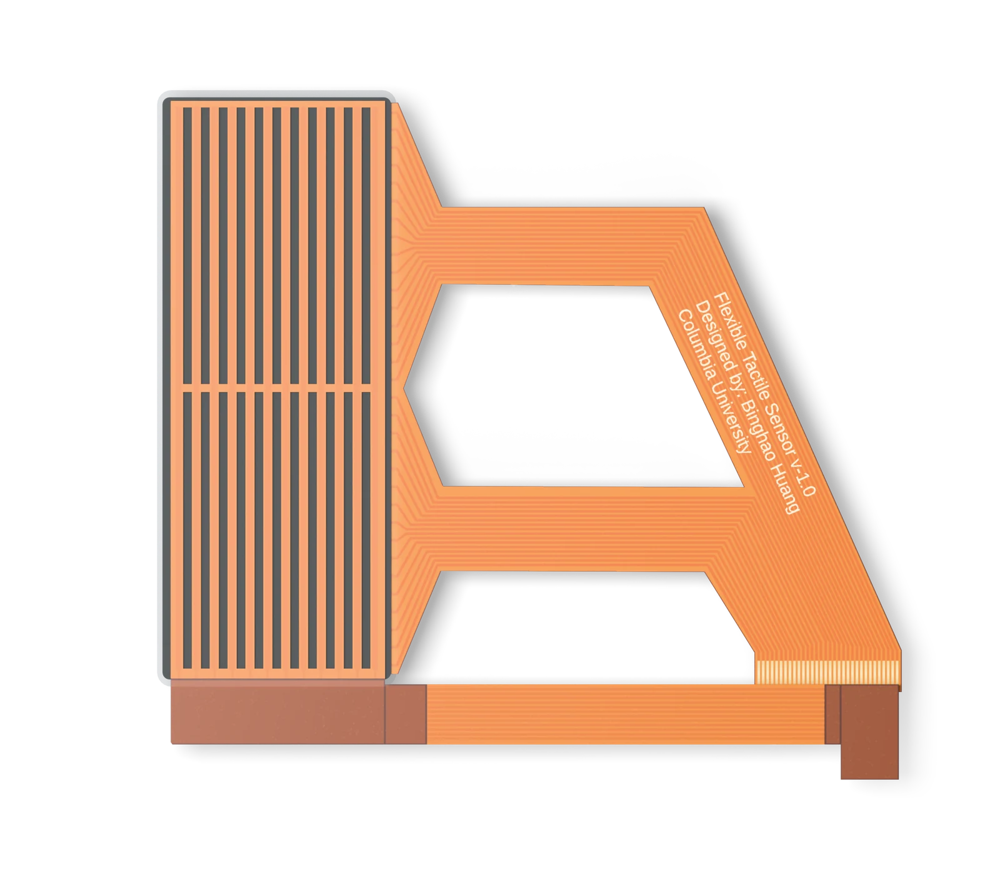

This guide walks you through building one **FlexiTac-V2** sensor (32 × 12 taxels), connecting it to a **32 × 16 reading board**, and streaming it live to a heatmap on your computer. This is the standard setup: the fabrication guide, the firmware and PyFlexiTac all default to it. Each step links to a detailed page.

<!-- build-figure: generated by build_web.py (see doc/_src/README.md); edit there, not here -->
<div class="build" id="build-figure">
<div class="build-col build-a">
<figure class="figure exploded">
<div class="xstage">

<svg class="xlines" viewBox="0 0 1600 1200" preserveAspectRatio="none" aria-hidden="true"><line x1="1396" y1="191" x2="1140" y2="263"/><circle cx="1140" cy="263" r="5"/><line x1="1400" y1="821" x2="1192" y2="677"/><circle cx="1192" cy="677" r="5"/><line x1="528" y1="324" x2="727" y2="507"/><circle cx="727" cy="507" r="5"/><line x1="528" y1="324" x2="846" y2="640"/><circle cx="846" cy="640" r="5"/><line x1="992" y1="1080" x2="583" y2="932"/><circle cx="583" cy="932" r="5"/><line x1="992" y1="1080" x2="728" y2="977"/><circle cx="728" cy="977" r="5"/><line x1="655" y1="1152" x2="495" y2="1126"/><circle cx="495" cy="1126" r="5"/><line x1="217" y1="742" x2="345" y2="910"/><circle cx="345" cy="910" r="5"/></svg>
<span class="xmark" style="left:87.3%;top:16.0%">1</span>
<span class="xmark" style="left:87.6%;top:68.4%">2</span>
<span class="xmark" style="left:33.0%;top:27.0%">3</span>
<span class="xmark" style="left:62.0%;top:90.0%">4</span>
<span class="xmark" style="left:41.0%;top:96.0%">5</span>
<span class="xmark" style="left:13.6%;top:61.9%">6</span>
</div>
<figcaption>(a) The whole setup</figcaption>
</figure>
<ol class="layers">
<li>FlexiTac sensor</li>
<li>Gripper finger (<a href="/doc/robot-learning/data-collection/#umi">UMI</a>)</li>
<li>FFC extenders</li>
<li>Flat flexible cables</li>
<li>32 × 16 reading board</li>
<li>Arduino Nano</li>
</ol>
</div>
<div class="build-col build-b">
<figure class="figure exploded">
<div class="xstage">

<svg class="xlines" viewBox="0 0 1600 1400" preserveAspectRatio="none" aria-hidden="true"><line x1="819" y1="281" x2="500" y2="421"/><circle cx="500" cy="421" r="5"/><line x1="1452" y1="958" x2="1324" y2="1084"/><circle cx="1324" cy="1084" r="5"/><line x1="1487" y1="1322" x2="1391" y2="1224"/><circle cx="1391" cy="1224" r="5"/><line x1="257" y1="1280" x2="385" y2="1140"/><circle cx="385" cy="1140" r="5"/><g class="xdim"><line x1="271" y1="108" x2="614" y2="108"/><line x1="271" y1="91" x2="271" y2="156"/><line x1="614" y1="91" x2="614" y2="156"/><line x1="215" y1="164" x2="215" y2="1079"/><line x1="196" y1="164" x2="262" y2="164"/><line x1="196" y1="1079" x2="262" y2="1079"/></g></svg>
<span class="xmark" style="left:51.2%;top:20.1%">7</span>
<span class="xmark" style="left:90.8%;top:68.5%">8</span>
<span class="xmark" style="left:93.0%;top:94.5%">9</span>
<span class="xmark" style="left:16.1%;top:91.4%">10</span>
<span class="xdimt" style="left:27.7%;top:4.9%">24 mm</span>
<span class="xdimt v" style="left:10.7%;top:44.4%">64 mm</span>
</div>
<figcaption>(b) The sensor pad, from above</figcaption>
</figure>
<ol class="layers" style="counter-reset: layer 6">
<li>Sensing area</li>
<li>32 gold fingers</li>
<li>12 gold fingers</li>
<li>Stiffeners</li>
</ol>
</div>
</div>
<!-- /build-figure -->

:::tip[Need a different shape or size?]
Generate the two FPCs for your own gripper or fingertip with [FlexiTac-Gen](/flexitac-gen/). It also tells you which reading board fits your design. Ordering and fabrication work the same way. Flash and read it with your sensor's rows and columns, as described in [Match the reader to the firmware](/doc/get-started/pyflexitac/#rows). Designs that need the 32 × 32 board aren't covered by these docs yet.
:::

## At a glance

<div class="stats">
<div class="stat"><b>&lt; 3 min</b><span>to fabricate one sensor</span></div>
<div class="stat"><b>~$4</b><span>materials per sensor</span></div>
<div class="stat"><b>~$30</b><span>reading board + Arduino Nano</span></div>
<div class="stat"><b>1–2 weeks</b><span>FPC / PCB lead time</span></div>
</div>

Costs are the estimates from the [Hardware Fabrication Guide](https://docs.google.com/document/d/1bvz6AL7BUkhj4Dj7n9DFXTjnGIX4-ziN8-smiCKpVZU/edit?usp=sharing) (March 2026). Cables, connectors and consumables add roughly $10.

### What you need

- **A computer** running Linux or macOS (the platforms the existing guides document), with **Python 3.11 or newer**.
- **An Arduino Nano** and a USB cable that carries data, not just power.
- **Two FPCs and one reading board**, ordered from a PCB manufacturer using the open design files (step 1).
- **Consumables:** pressure-sensitive conductive film (Velostat or Linqstat), adhesive laminating sheets and polyimide tape.
- **Flat flexible cables** (16-pin and 32-pin) and **FFC extenders** (20-pin and 40-pin) to connect the sensor to the board.

No soldering is needed to fabricate the sensor itself. You can have the reading board assembled by the manufacturer (PCBA) when you order it.

## Steps

:::steps
#### Order the parts
Upload the Gerber files for the top FPC, the bottom FPC and the reading board to a PCB manufacturer, and order the consumables from the bill of materials. Order a few spare sensors: they're cheap, and spares make debugging easier.

[Bill of materials and ordering settings →](/doc/get-started/order-parts/)

#### Fabricate the sensor
Laminate each FPC onto an adhesive sheet, put Velostat between them, seal the edges with polyimide tape and plug the gold fingers into the connectors. This takes under three minutes.

[Step-by-step fabrication with photos →](/doc/get-started/fabricate/)

#### Stream the sensor
Open PyFlexiTac's firmware sketch in the Arduino IDE and upload it to the reading board's Arduino Nano. Then install PyFlexiTac, find the serial port and open a live heatmap:

```bash
pip install "flexitac[examples]"
flexitac-find-port
flexitac-heatmap --port /dev/ttyUSB0
```

[Stream the sensor →](/doc/get-started/stream/)
:::

## Already have an assembled sensor?

If someone handed you a working sensor and reading board, these four commands are the entire setup:

```bash title="Terminal"
pip install "flexitac[examples]"      # Python 3.11+
flexitac-flash                        # needs arduino-cli; or use the Arduino IDE
flexitac-find-port                    # which /dev/tty* is the sensor
flexitac-heatmap --port /dev/ttyUSB0  # press the pad
```

## You're done when…

- [ ] `flexitac-stream` ([Check the signal](/doc/get-started/pyflexitac/#stream)) reports a steady frame rate (about **100+ fps** for a 32 × 12 sensor).
- [ ] `raw_max` changes when you press the sensor, and isn't stuck at 0 or 255.
- [ ] A bright spot in `flexitac-heatmap` follows your fingertip across **every** row and column.

:::tip[Stuck?]
Most first-time problems are a serial permission, a cable that only charges, or firmware and reader disagreeing on the number of rows. [Troubleshooting](/doc/get-started/troubleshooting/) covers each of these by symptom. You can also ask on the [Discord](https://discord.gg/6gw887Vxms).
:::
