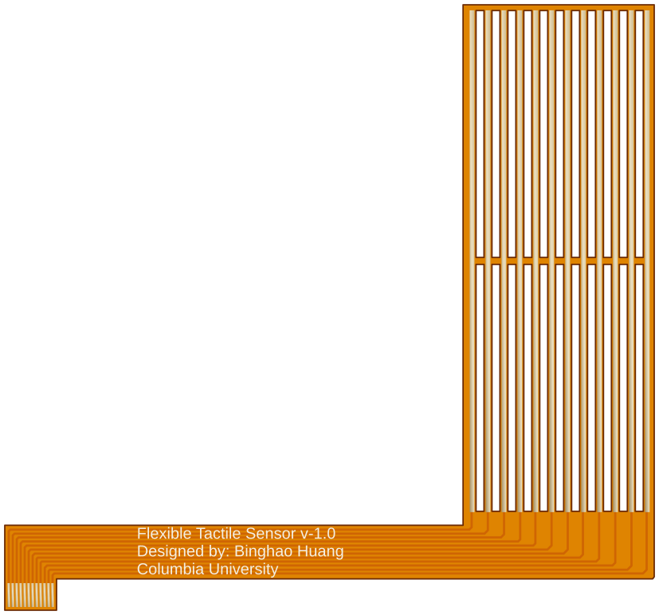
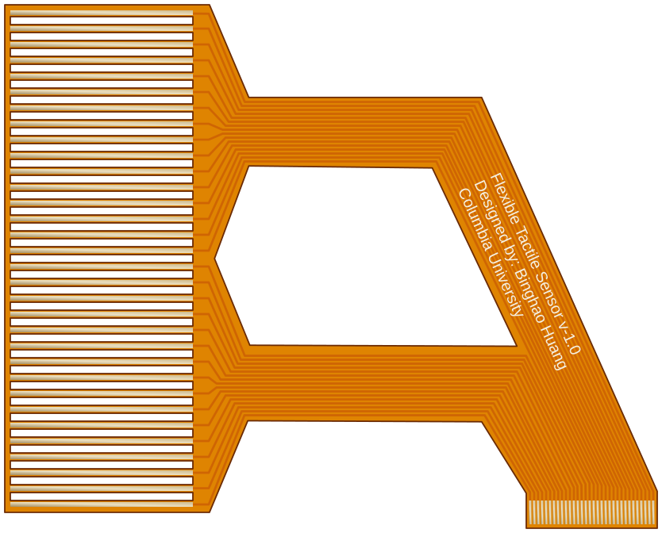
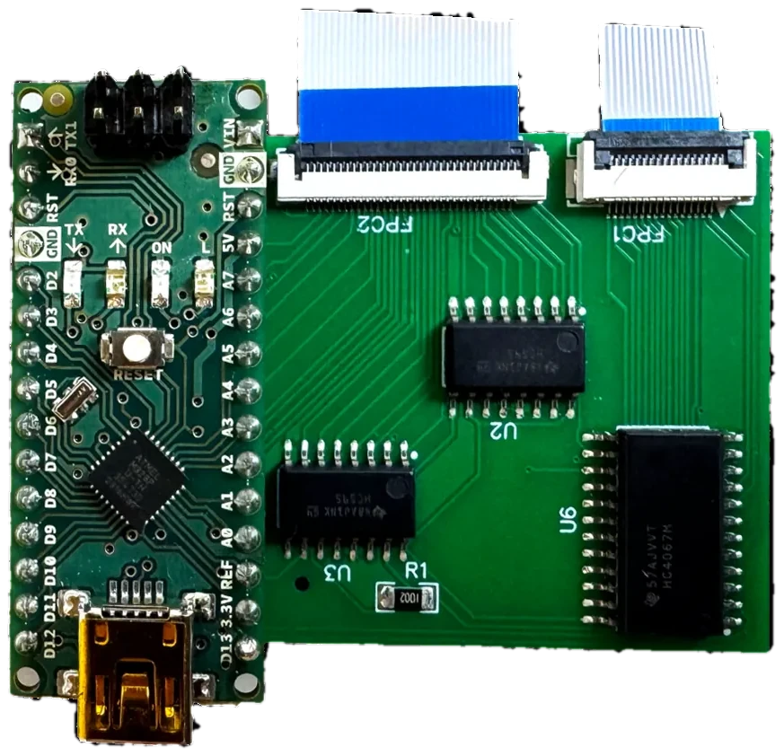
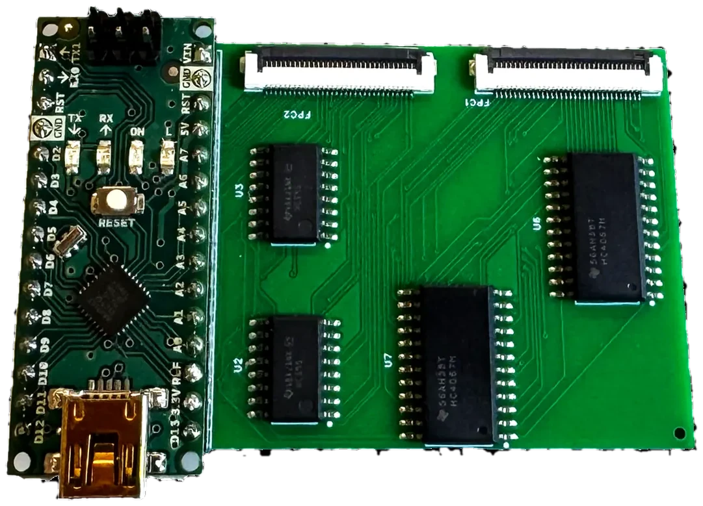
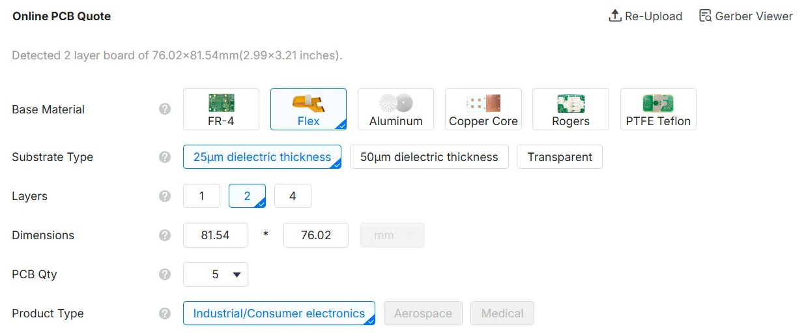
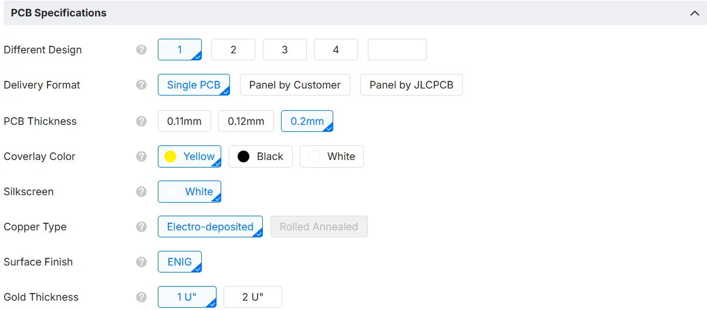
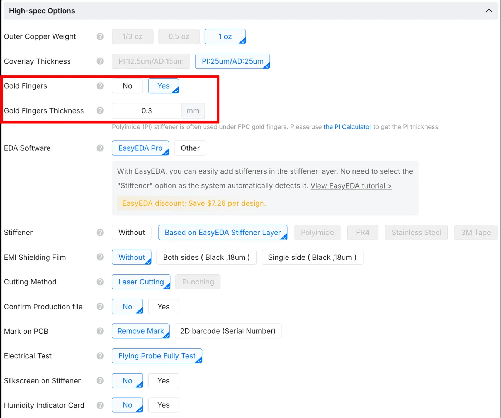
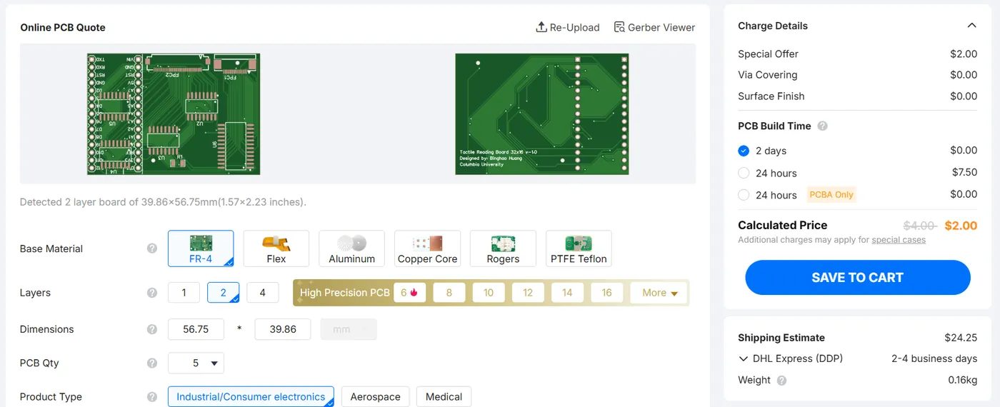
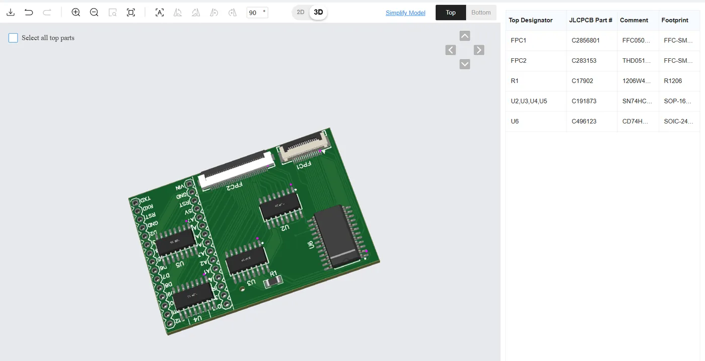

You need three things for a FlexiTac-V2 setup: the **two sensor FPCs** and the **reading board** from a PCB manufacturer, plus a few **off-the-shelf parts** (Arduino Nano, cables, consumables). Fabrication takes 1–2 weeks including shipping, so order everything at once.

:::note
Adapted from the [FlexiTac Hardware Fabrication Guide](https://docs.google.com/document/d/1bvz6AL7BUkhj4Dj7n9DFXTjnGIX4-ziN8-smiCKpVZU/edit?usp=sharing) (Google Docs, March 2026).
:::

## Design files {#design-files}

| Part | Files | Download |
| --- | --- | --- |
| **Top FPC** (V2 sensor) | Gerber, EasyEDA Pro export of 2026-03-02 | [Gerber_Top_FPC_2026-03-02.zip](/flexitac-gen/static/vendor/flexitac-v2/Gerber_Top_FPC_2026-03-02.zip) |
| **Bottom FPC** (V2 sensor) | Gerber, EasyEDA Pro export of 2026-03-02 | [Gerber_Bottom_FPC_2026-03-02.zip](/flexitac-gen/static/vendor/flexitac-v2/Gerber_Bottom_FPC_2026-03-02.zip) |
| **Reading board 32 × 16** (recommended) | Gerber, BOM, pick-and-place | [FlexiTac_reading_board_32x16.zip](/flexitac-gen/static/vendor/flexitac-reader/FlexiTac_reading_board_32x16.zip) · [schematic (PDF)](https://drive.google.com/file/d/1KEzet6f4s1i1d-GOSpwD5-4Peu2S67hL/view?usp=drive_link) |
| **Reading board 32 × 32** (development) | Gerber, BOM, pick-and-place | [FlexiTac_reading_board_32x32.zip](/flexitac-gen/static/vendor/flexitac-reader/FlexiTac_reading_board_32x32.zip) · [schematic (PDF)](https://drive.google.com/file/d/1bmmO034ZeR81Ba8OML_0MlkXvKADsflr/view?usp=drive_link) |

The downloads are unchanged copies of the files linked from the guide's "PCB Related Files" table, served from FlexiTac-Gen. Each reading-board ZIP bundles that board's Gerber ZIP, BOM and pick-and-place file; unzip it and upload the inner `Gerber_*.zip` as the Gerber.

<figure><figcaption>Top FPC</figcaption></figure>
<figure><figcaption>Bottom FPC</figcaption></figure>

### Which reading board? {#which-board}

Order the **32 × 16 board**. According to the Fabrication Guide, this board is enough to read the V2 sensor, and the firmware and PyFlexiTac support it out of the box.

<figure><figcaption>32 × 16 reading board (use this one)</figcaption></figure>
<figure><figcaption>32 × 32 reading board (development)</figcaption></figure>

| Board | Status | Reads | Connectors | Use it for |
| --- | --- | --- | --- | --- |
| **32 × 16** | **Recommended**: the firmware and PyFlexiTac support it | Up to 32 lines on one side and 16 on the other | 32-pin + 16-pin FFC | FlexiTac-V2, and custom sensors that fit within 32 × 16 |
| **32 × 32** | **Development**: design files only, firmware not in these docs yet | Up to 32 lines on each side | 32-pin + 32-pin FFC | Larger custom sensors, if you're ready to adapt the firmware |

If you designed a custom sensor with [FlexiTac-Gen](/flexitac-gen/), the app tells you which board fits it.

:::tip[Order spares]
FPCs are cheap at quantity: about **$2.57 per top + bottom pair at 100 units**. Order a few extra sensors. Spares let you swap out a damaged sensor in seconds and tell a bad sensor from a bad board.
:::

## Bill of materials {#bom}

Prices and links are from the Fabrication Guide. **Price** is what you pay for the **Purchase**; **Per sensor** or **Per setup** is the share one build uses, since a roll or pack lasts many sensors.

### Sensor

| # | Part | Purchase | Price | Per sensor | Where |
| ---: | --- | --- | ---: | ---: | --- |
| 1 | **Top and bottom FPC** (key component) | A batch, one pair per sensor | Quoted per order | ~$2.57 at 100 units | PCB manufacturer, [see below](#order-the-fpcs) |
| 2 | Polyimide tape | 1 roll, 4 in × 108 ft: ~100 sensors | $21.98 | ~$0.22 | [Amazon](https://www.amazon.com/dp/B07N4QTXWS) |
| 3 | Pressure-sensitive conductive sheet (Velostat / Linqstat) | 1 sheet: ~20 sensors | $4.95 | ~$0.25 | [Adafruit 1361](https://www.adafruit.com/product/1361) |
| 4 | Adhesive laminating sheets | 1 pack: ~100 sensors | $6.29 | ~$0.06 | [Amazon](https://a.co/d/02y7MDdy) |
| | **Per sensor** | | | **~$3.10** | The guide budgets ~$4. |

The FPC price drops with quantity: ~$2.57 a pair is the 100-unit price, and a first order of 5–10 costs more per sensor.

### Reading board

| # | Part | Purchase | Price | Per setup | Where |
| ---: | --- | --- | ---: | ---: | --- |
| 5 | **Reading board PCB**, assembled (key component) | 5 boards, one quote | Quoted per order | ~$5 | PCB manufacturer, [see below](#order-the-reading-board) |
| 6 | Arduino Nano | 1 | $25.10 | $25.10 | [Amazon](https://www.amazon.com/dp/B0097AU5OU) |
| | **Per setup** | | | **~$30** | |

### Cables and connectors

| # | Part | Purchase | Price | Per setup | Where |
| ---: | --- | --- | ---: | ---: | --- |
| 7 | Flexible flat cable, 32-pin | 5-pack | $5.09 | ~$1.02 | [Amazon](https://a.co/d/0aJnyShh) |
| 8 | Flexible flat cable, 16-pin | 5-pack | $6.09 | ~$1.22 | [Amazon](https://www.amazon.com/dp/B07RWF5D83) |
| 9 | Mini-USB cable (must carry data) | 2-pack | $11.99 | ~$6.00 | [Amazon](https://www.amazon.com/dp/B091SQKMQK) |
| 10 | 20-pin FFC extender | 1 | $0.95 | $0.95 | [Adafruit 5203](https://www.adafruit.com/product/5203) |
| 11 | 40-pin FFC extender | 1 | $0.95 | $0.95 | [Adafruit 4523](https://www.adafruit.com/product/4523) |
| 12 | FFC extender, easy-install alternative to #10–11 | 2 (16-pin and 32-pin) | $0.55–0.88 each | $1.10–1.76 | [AliExpress](https://www.aliexpress.us/item/3256801662408481.html) |
| | **Per setup** | | | **~$10** | With #10–11 |

:::note[Which FFC extenders?]
The Adafruit extenders (#10, #11) used in the video are compact but need careful alignment and some practice to install. The AliExpress extenders (#12) are easier to install, although bulkier. On AliExpress, select the **16-pin** and **32-pin** variants.
:::

## Order the FPCs {#order-the-fpcs}

The guide's screenshots use JLCPCB's online quote. Order the top and bottom FPCs as two separate designs.

:::steps
#### Upload the Gerber and choose Flex
Upload `Gerber_Top_FPC_2026-03-02.zip`. Set **Base Material** to **Flex**, keep 2 layers and choose your quantity.

#### Set the thickness to 0.2 mm
Under **PCB Specifications**, set **PCB Thickness** to **0.2 mm**. You can leave the other options at their defaults, as in the screenshot (yellow coverlay, ENIG finish).

#### Enable gold fingers
Under **High-spec Options**, set **Gold Fingers: Yes** and **Gold Fingers Thickness: 0.3 mm**. The gold fingers are the ends that plug into the FFC connectors. The V2 Gerbers include a stiffener layer under them, which the quote form picks up automatically ("Based on EasyEDA Stiffener Layer").

#### Repeat for the bottom FPC
Repeat steps 1–3 with `Gerber_Bottom_FPC_2026-03-02.zip`. The bottom FPC needs the same thickness and gold fingers. At a 100-unit scale, a top + bottom pair costs about $2.57.
:::

## Order the reading board {#order-the-reading-board}

Have the manufacturer assemble the board (PCBA) so the components arrive already soldered.

:::steps
#### Upload the Gerber and enable assembly
Upload the reading board's Gerber (`Gerber_16_32.zip` for the 32 × 16 board). Keep **FR-4**, 2 layers, then enable **PCB Assembly** with the assembly side set as in the guide (**Bottom**).

#### Upload the BOM and pick-and-place files
Upload `BOM_05mm_FFC_16_32_1mux_4sr_2025-11-01.csv` and `PickAndPlace_PCB_05mm_FFC_16_32_1mux_4sr_2025-11-01.csv`. Check that every component is in stock. If one isn't, replace it with a part of the same function **and the same package**, so it fits the footprint on the board:

| Designator | In the BOM | An acceptable replacement |
| --- | --- | --- |
| FPC1 | FFC05001-16SBB124W5M (LCSC C2856801) | 16-pin FFC connector, 0.5 mm pitch, surface-mount, with the same land pattern (compare the datasheets) |
| FPC2 | THD0515-32CL-SN (LCSC C283153) | 32-pin FFC connector, 0.5 mm pitch, surface-mount, with the same land pattern |
| U2–U5 | SN74HC595NSR | Any 74HC595 8-bit shift register in the 5.3 mm-wide SOP-16 package. The common 3.9 mm SOIC-16 doesn't fit. |
| U6 | CD74HC4067M96 | Any 74HC4067 16-channel analog multiplexer in the 7.5 mm-wide SOIC-24 package |
| R1 | 1206W4F1002T5E | 10 kΩ resistor, 1206 package |

Not sure a replacement fits? Ask on [Discord](https://discord.gg/6gw887Vxms) or [open an issue](https://github.com/FlexiTac/FlexiTac/issues) in the hardware repository before you order.

 file.")

#### Review the placement
Check the assembly draft and the 3D render: every part should sit on its footprint and face the right way.

#### Place the order
The quoted price covers 5 boards. Delivery takes about one week.
:::

:::note[Licensing]
The FlexiTac hardware is © 2026 Columbia University, licensed [CC BY-NC 4.0](https://creativecommons.org/licenses/by-nc/4.0/). You may build, share and adapt it for non-commercial purposes, with attribution. The license doesn't cover commercial use.
:::

## Next

When the parts arrive, continue to [Fabricate a sensor](/doc/get-started/fabricate/).
