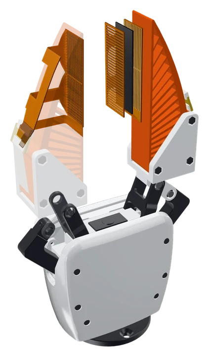
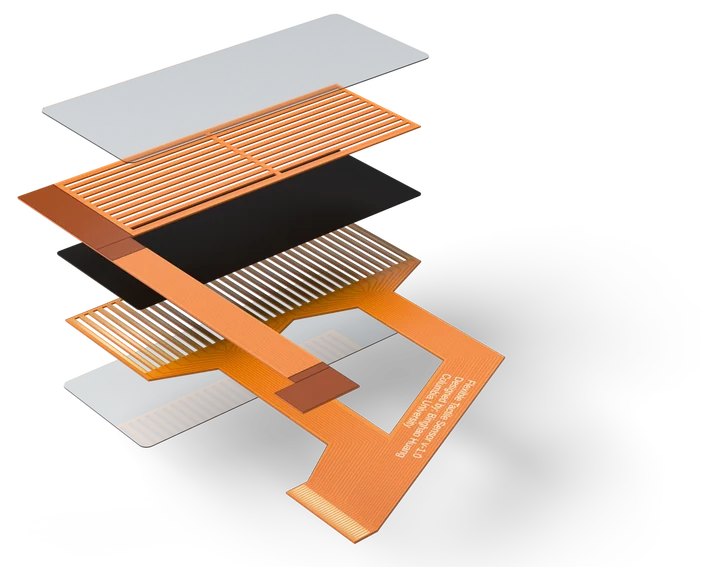
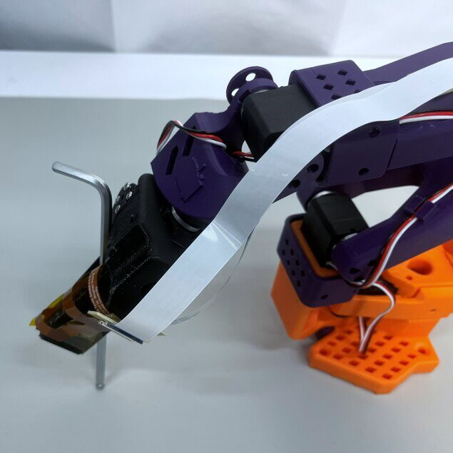
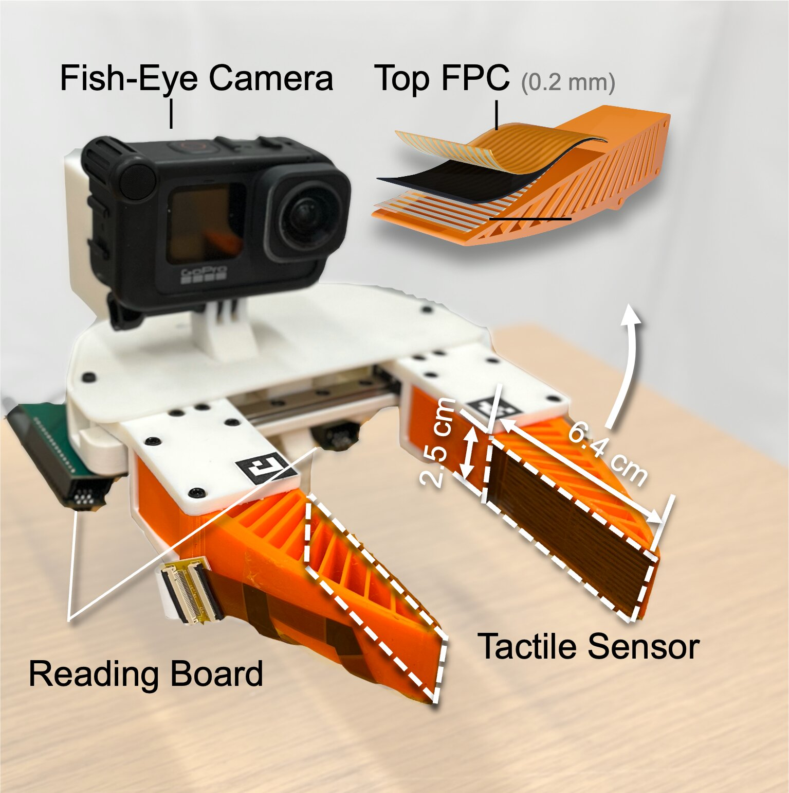
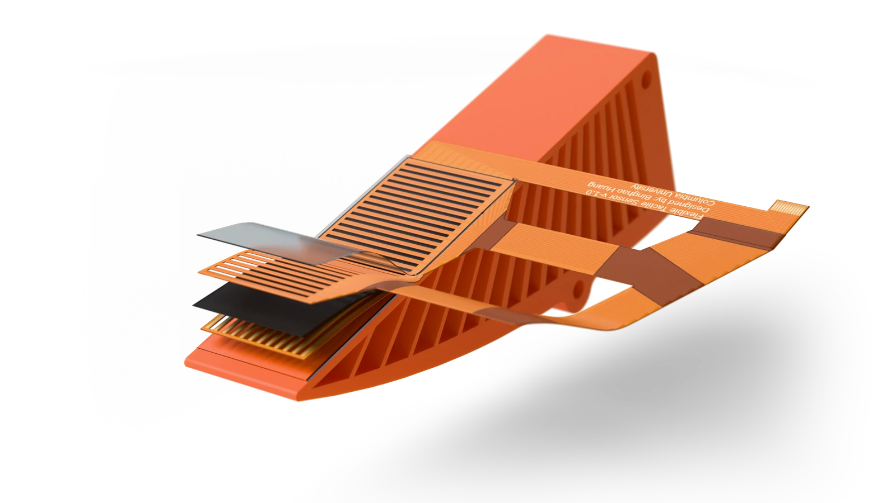

Build your first sensor, customize it for your robot, and bring touch into your learning pipeline.

<a class="btn primary" href="/doc/get-started/">Quickstart<svg viewBox="0 0 24 24" aria-hidden="true"><path d="M5 12h14m-6-6 6 6-6 6"/></svg></a><a class="btn" href="/">Explore FlexiTac</a>

:::cards[flow]
#### Design | /flexitac-gen/ | grid

FlexiTac on xArm

Design a sensor that fits your own robot.

<a class="btn primary" href="/flexitac-gen/">Open FlexiTac-Gen<svg viewBox="0 0 24 24" aria-hidden="true"><path d="M5 12h14m-6-6 6 6-6 6"/></svg></a>

#### Build | /doc/get-started/ | layers

Build a sensor

Two flexible PCBs around a pressure-sensitive film. Under 3 minutes and about $4 in materials.

<a class="btn primary" href="/doc/get-started/">Start building<svg viewBox="0 0 24 24" aria-hidden="true"><path d="M5 12h14m-6-6 6 6-6 6"/></svg></a>

#### Integrate | /doc/robot-learning/data-collection/ | robot

<figure><figcaption>Teleoperation</figcaption></figure><figure><figcaption>UMI data</figcaption></figure>

Mount it and collect data

Teleoperate a robot with LeFlexiTac, or collect UMI data by hand with Touch in the Wild.

<a class="btn primary" href="/doc/robot-learning/data-collection/">Data collection<svg viewBox="0 0 24 24" aria-hidden="true"><path d="M5 12h14m-6-6 6 6-6 6"/></svg></a>

#### Learn | /doc/robot-learning/imitation-learning/ | net

Learn with touch

Collect tactile data and train policies, on real robots or in simulation.

<ul class="flow-card-tags"><li><a href="/doc/robot-learning/data-collection/">Data collection</a></li><li><a href="/doc/robot-learning/tactile-representation/">Representation</a></li><li><a href="/doc/robot-learning/imitation-learning/">Imitation learning</a></li><li><a href="/doc/robot-learning/vla/">VLA</a></li><li><a href="/doc/robot-learning/reinforcement-learning/">Reinforcement learning</a></li><li><a href="/doc/robot-learning/pretraining/">Pretraining</a></li><li><a href="/doc/robot-learning/world-models/">World models</a></li></ul>

<a class="btn primary" href="/doc/robot-learning/imitation-learning/">Start learning<svg viewBox="0 0 24 24" aria-hidden="true"><path d="M5 12h14m-6-6 6 6-6 6"/></svg></a>

:::

<figure class="figure viewer3d" data-viewer3d data-src="/doc/assets/3d/flexitac-umi.glb" data-env="/doc/assets/3d/studio.hdr" data-shadow="0" data-orbit="334deg 70deg 0.40m" data-target="-0.008m 0.048m 0.013m" data-fov="13.6deg">

<button class="v3d-start" type="button" data-v3d-start><svg viewBox="0 0 24 24" aria-hidden="true"><path d="M21 12a9 9 0 1 1-3-6.7"/><path d="M21 3v6h-6"/></svg>Rotate in 3D</button>

<label class="v3d-peel">Assembled<input type="range" min="0" max="1" step="0.01" value="1" aria-label="Peel the layers apart" data-v3d-peel>Peeled</label>
<button class="v3d-reset" type="button" data-v3d-reset>Reset view</button>

<figcaption>A FlexiTac sensor on a UMI soft finger, peeled apart.</figcaption>
</figure>

:::cards
#### Hardware | /doc/get-started/fabricate/ | cpu
Fabricate and assemble your sensor.

#### Customization | /flexitac-gen/ | sliders
Design sensors for your robot.

#### Robot learning | /doc/robot-learning/data-collection/ | net
Collect data and train with touch.

#### Simulation | /doc/simulation/ | cube
Model tactile contact in simulation.
:::

Every repository, design file, paper and dataset: <a href="/doc/resources/">All resources →</a>

<h2 id="community">Built by the community</h2><a href="https://binghao-huang.github.io/Awesome-FlexiTac/" target="_blank" rel="noopener">Explore &amp; contribute →</a>

:::timeline
:::

:::community
<!-- Approved robots from "Share your robot" issues, oldest first. Each is a heading line
     "#### Robot name | https://project.link | /doc/assets/community/robot-name.webp" with a credit line under it.
     See "Feature a community robot" in doc/_src/README.md. -->
:::

<a class="share-slot" href="https://github.com/FlexiTac/FlexiTac.github.io/issues/new?template=share-your-robot.yml" target="_blank" rel="noopener"><svg viewBox="0 0 24 24" aria-hidden="true"><circle cx="12" cy="12" r="9"/><path d="M12 8v8M8 12h8"/></svg><b>Your robot</b>could be next</a>

<h2 id="share">Share your robot</h2>

Built FlexiTac into your own gripper, hand or robot? Send it in. We review every submission, then feature it here with credit.

<ol class="share-steps"><li>Submit</li><li>We review</li><li>Featured here</li></ol>

<a class="btn primary" href="https://github.com/FlexiTac/FlexiTac.github.io/issues/new?template=share-your-robot.yml" target="_blank" rel="noopener">Submit your robot<svg viewBox="0 0 24 24" aria-hidden="true"><path d="M5 12h14m-6-6 6 6-6 6"/></svg></a><a class="btn" href="https://discord.gg/6gw887Vxms" target="_blank" rel="noopener">Ask on Discord</a>

