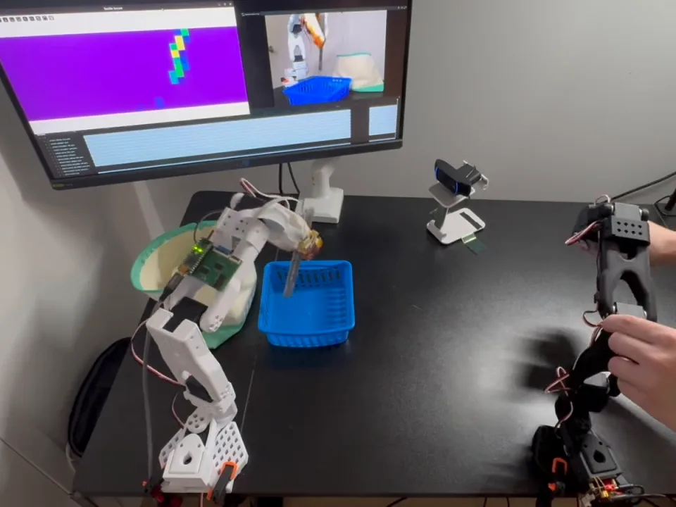
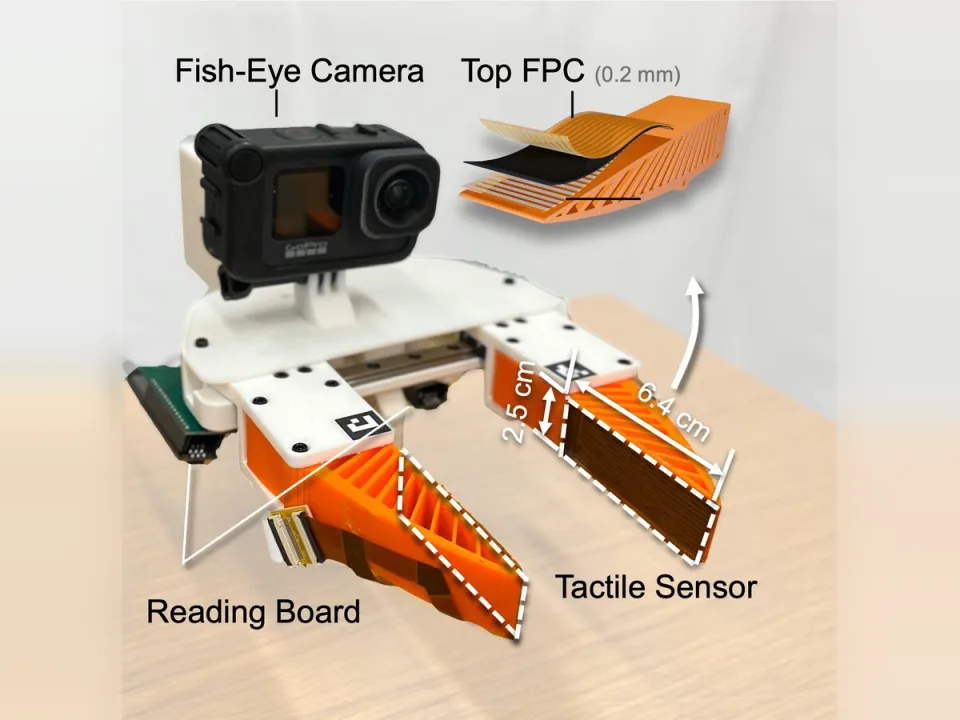

A tactile demonstration records what the sensor feels, what the camera sees and what the gripper does, all at the same moments. There are two ways to collect one.

<a class="mode" href="#teleoperation">TeleoperationDrive a robot arm and record from the robot itself. One sensor, on the moving jaw.</a>
<a class="mode" href="#umi">UMI dataHold the gripper and do the task yourself, anywhere, no robot needed. A sensor on each finger. Needs its own firmware.</a>

:::cards
#### Simulation | /doc/simulation/ | sim
A third source: generate visuo-tactile demonstrations in Isaac Sim, without physical hardware.
:::

**New to robot learning?** Start with teleoperation. It is the lowest-cost setup and uses the sensor exactly as these docs set it up.

## What each source records {#outputs}

| Source | What you get | Format |
| --- | --- | --- |
| Teleoperation (LeFlexiTac) | A LeRobot dataset: the tactile map, camera and joint states of each frame, at 30 fps | [LeFlexiTac docs](https://tna001-ai.github.io/LeFlexiTac/docs.html#reproduction) |
| Handheld UMI (Touch in the Wild) | GoPro video and tactile JSON logs recorded with ROS 2, aligned by a SLAM pipeline into one `dataset.zarr.zip` | [README: SLAM pipeline](https://github.com/XinyueZhuXY/touch_in_the_wild#creating-a-dataset-with-the-slam-pipeline) |
| Simulation (Isaac Sim) | One `.npz` per demonstration: the four pads' tactile maps, camera images, joint states and actions | [Its keys and shapes](/doc/simulation/#web) |

## Teleoperation {#teleoperation}

You move a leader arm and the follower robot copies it, so the recorded actions are the robot's own. The open setup is [LeFlexiTac](https://tna001-ai.github.io/LeFlexiTac/), which adds FlexiTac to [LeRobot](https://github.com/huggingface/lerobot) on the low-cost SO-100/101 arm.

<dl class="facts">
<dt>Robot</dt><dd>SO-100/101 leader and follower arms, a camera and a Linux machine</dd>
<dt>Sensor</dt><dd>One standard FlexiTac sensor (32&nbsp;×&nbsp;12), on the follower's 3D-printed moving jaw only</dd>
<dt>Reader</dt><dd>PyFlexiTac, with the firmware from <a href="/doc/get-started/stream/">Stream the sensor</a></dd>
<dt>Output</dt><dd>A LeRobot dataset: the tactile map next to the camera and joint states, at 30 fps</dd>
</dl>

<figure class="sample">
<video src="/doc/assets/video/teleop-leflexitac.mp4" poster="/doc/assets/img/sample-teleop.webp" width="1200" height="900" muted loop playsinline preload="none" data-inview aria-label="An operator moves the leader arm and the follower arm copies it, while the screen shows the live tactile map and camera view"></video>
<figcaption>SampleRecording a LeFlexiTac demonstration. The leader arm (right) drives the follower, and the screen shows the tactile map and camera view going into the dataset.</figcaption>
</figure>

The full guide is **steps 01–08** of the [LeFlexiTac docs](https://tna001-ai.github.io/LeFlexiTac/docs.html#reproduction), from building the robot to collecting data. In short:

:::steps
#### Build the arm and the tactile jaw
Assemble the arms from the [SO-ARM100 guide](https://github.com/TheRobotStudio/SO-ARM100), then print LeFlexiTac's Moving Jaw and Wrist Roll and fit them.

#### Install LeFlexiTac
Install the [fork](https://github.com/TNA001-AI/lerobot_tactile) from source in a Python 3.12 environment. `pip install lerobot` gives you upstream LeRobot, which has no tactile support.

#### Calibrate the arms and mount the sensor
Calibrate and test teleoperation with [LeRobot's SO-101 walkthrough](https://huggingface.co/docs/lerobot/il_robots), then mount the sensor and confirm it with `flexitac-heatmap`.

#### Record demonstrations
Record with `lerobot-record` and the `so_tactile_follower` robot type.
:::

Then train [ACT or Diffusion Policy](/doc/robot-learning/imitation-learning/#leflexitac), or [Pi0.5 and SmolVLA](/doc/robot-learning/vla/#leflexitac), on your dataset.

## UMI data {#umi}

You hold a [UMI](https://github.com/real-stanford/universal_manipulation_interface)-style gripper and do the task yourself, indoors or outdoors, with no robot. A GoPro on the gripper records vision, and a FlexiTac sensor on each soft finger records touch. The open setup is [Touch in the Wild](https://binghao-huang.github.io/touch_in_the_wild/) (NeurIPS 2025). Its authors used it to collect more than 2,700 demonstrations across 43 tasks in 12 environments.

:::caution[Before you build: it needs different firmware]
Touch in the Wild reads the boards with its own code, not PyFlexiTac: a ROS 2 node while recording, and serial readers when running a policy. Both expect the older **text** output, 16 lines of 32 numbers per frame. The firmware in [Stream the sensor](/doc/get-started/stream/#flash) sends **binary** frames instead, so a board flashed from these docs won't work with Touch in the Wild as it is, and its repositories don't include matching firmware. Ask in its [issues](https://github.com/XinyueZhuXY/touch_in_the_wild/issues) or on the [Discord](https://discord.gg/6gw887Vxms) before you build.
:::

<dl class="facts">
<dt>Gripper</dt><dd>The UMI handheld gripper with Touch in the Wild's modifications, and a GoPro Hero&nbsp;9</dd>
<dt>Sensors</dt><dd>Two standard FlexiTac sensors (32&nbsp;×&nbsp;12), one on each soft finger</dd>
<dt>Reader</dt><dd>ROS 2 Humble on Ubuntu 22.04, with older text-format firmware (see the caution above)</dd>
<dt>Output</dt><dd>GoPro video and tactile streams, turned into a training dataset by a SLAM pipeline</dd>
<dt>Shared data</dt><dd>The <a href="https://huggingface.co/datasets/binghaohuang-robot/touch_in_the_wild-dataset" target="_blank" rel="noopener">Touch in the Wild dataset</a>. The pretraining set alone is about 88 GB.</dd>
</dl>

<figure class="sample">

<video src="/doc/assets/video/umi-outdoors.mp4" poster="/doc/assets/img/sample-umi-outdoors.webp" width="384" height="360" muted loop playsinline preload="none" data-inview aria-label="Grasping a cup outdoors: fish-eye view with the left and right tactile maps below"></video>Outdoors

<video src="/doc/assets/video/umi-shelf.mp4" poster="/doc/assets/img/sample-umi-shelf.webp" width="384" height="360" muted loop playsinline preload="none" data-inview aria-label="Pulling a roll from a crowded shelf: fish-eye view with the left and right tactile maps below"></video>Shelf

<video src="/doc/assets/video/umi-workbench.mp4" poster="/doc/assets/img/sample-umi-workbench.webp" width="384" height="360" muted loop playsinline preload="none" data-inview aria-label="Taking a tool from a bin on a workbench: fish-eye view with the left and right tactile maps below"></video>Workbench

<figcaption>Sample dataThree demonstrations from Touch in the Wild: the GoPro's fish-eye view, with the left and right fingers' tactile maps below it.</figcaption>
</figure>

:::steps
#### Build the gripper
Build the UMI gripper, then apply Touch in the Wild's top plate and finger holders and add the two sensors. [Gripper guide](https://docs.google.com/document/d/1Gxd2PzVo-sH_XbvnVw_r3eI5i3I3t0rr7JdhpN1PJMA/edit?tab=t.0#heading=h.dcjpnwh7wh40)

#### Set up the recording laptop
Give each reading board a fixed device name, then install the ROS 2 tactile packages. [Device names](https://github.com/XinyueZhuXY/touch_in_the_wild-data-collection#udev) · [ROS 2 setup](https://github.com/XinyueZhuXY/touch_in_the_wild-data-collection#ros)

#### Collect demonstrations
Record the tactile streams with ROS 2 while the GoPro films. [Data collection protocol](https://github.com/XinyueZhuXY/touch_in_the_wild-data-collection#protocol)

#### Turn the recordings into a dataset
Run the SLAM pipeline on the session folder. [README: SLAM pipeline](https://github.com/XinyueZhuXY/touch_in_the_wild#creating-a-dataset-with-the-slam-pipeline)
:::

Next, [pretrain the visuo-tactile encoder](/doc/robot-learning/pretraining/#touch-in-the-wild) or start from the released one, then train a [Diffusion Policy](/doc/robot-learning/imitation-learning/#touch-in-the-wild).

## Good data, either way {#tips}

- **Check every session before you record.** Run `flexitac-stream` or the heatmap and press each sensor: every row and column should respond. A dead row can't be fixed in data you've already recorded.
- **Mount on something slightly soft,** such as a fin-ray finger, so contact spreads over several taxels.
- **Keep the cable still at the connector.** Route the flat cable so it doesn't flex while the gripper moves.
- **Redo the baseline calibration after mounting.** The mount itself changes the resting baseline.
- **In your own code, record `raw` and the baseline,** not only `normalized`: it is scaled per frame and hides how hard the contact is ([why](/doc/get-started/pyflexitac/#normalized)).
- **Keep touch in sync.** LeFlexiTac records touch into the same dataset frames as the camera and joints, so train and run a policy at the frame rate you recorded at. Touch in the Wild shows a QR code to the camera before each demonstration to line up video and touch. In your own setup, record with PyFlexiTac's `sensor.read()`, which returns every received frame in order, and keep each frame's `timestamp_s` ([Read frames in Python](/doc/get-started/pyflexitac/#python)). It's host time, so USB delay is part of it.
- **Choose the tactile rate once.** The sensor streams around 100 fps, and a dataset usually samples it at the camera's rate: LeFlexiTac records at 30 fps. Either take the newest frame at each step (`read_latest()`) or keep every frame (`read()`) and resample later, but don't mix the two.
- **Look at a few episodes before you record many.** Play the tactile maps back next to the video: contact should appear when the gripper closes, and no taxel should stay stuck.
- **Another gripper?** [FlexiTac-Gen](/flexitac-gen/) designs a sensor that fits it.
