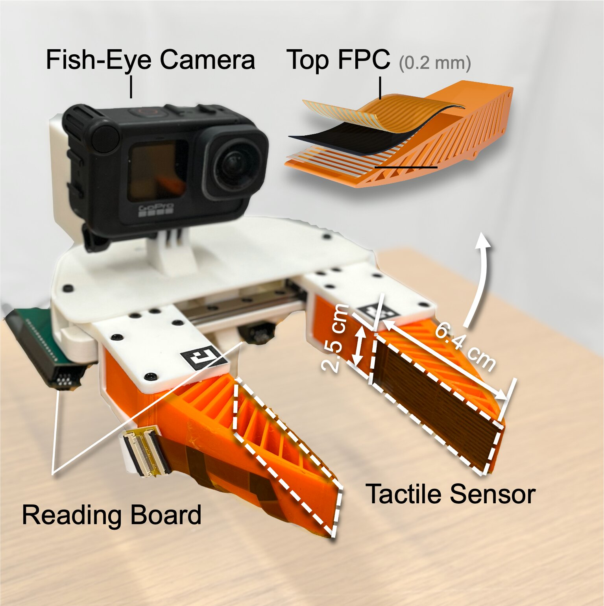
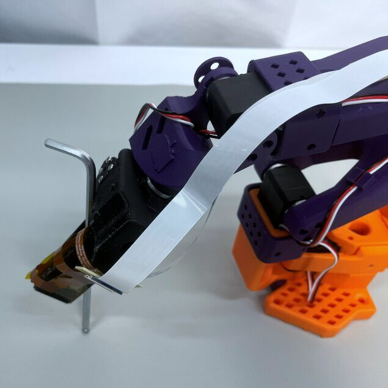
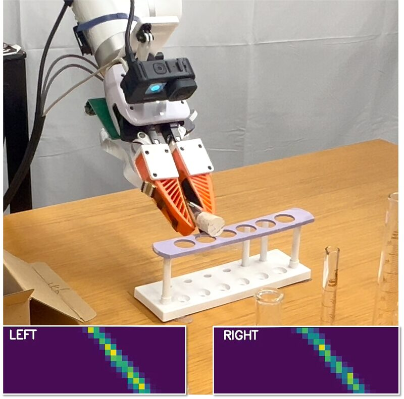
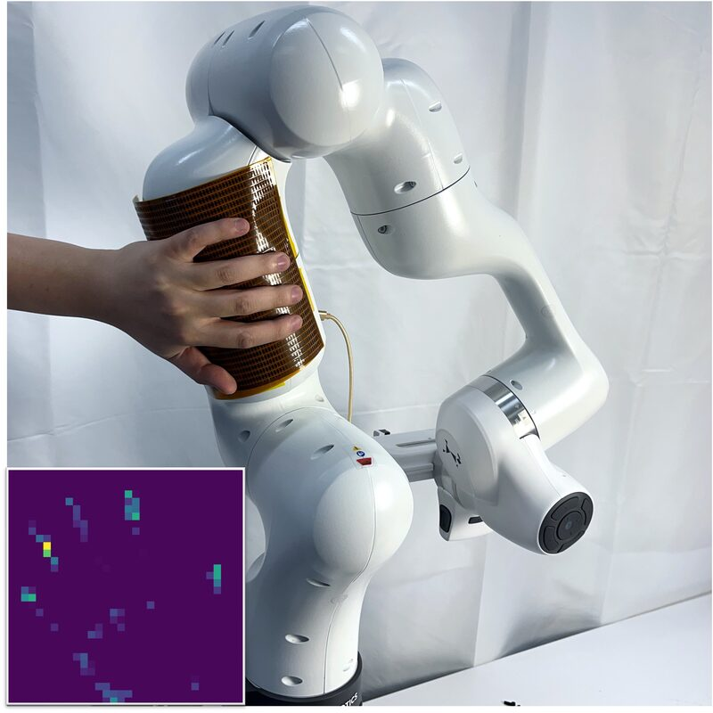
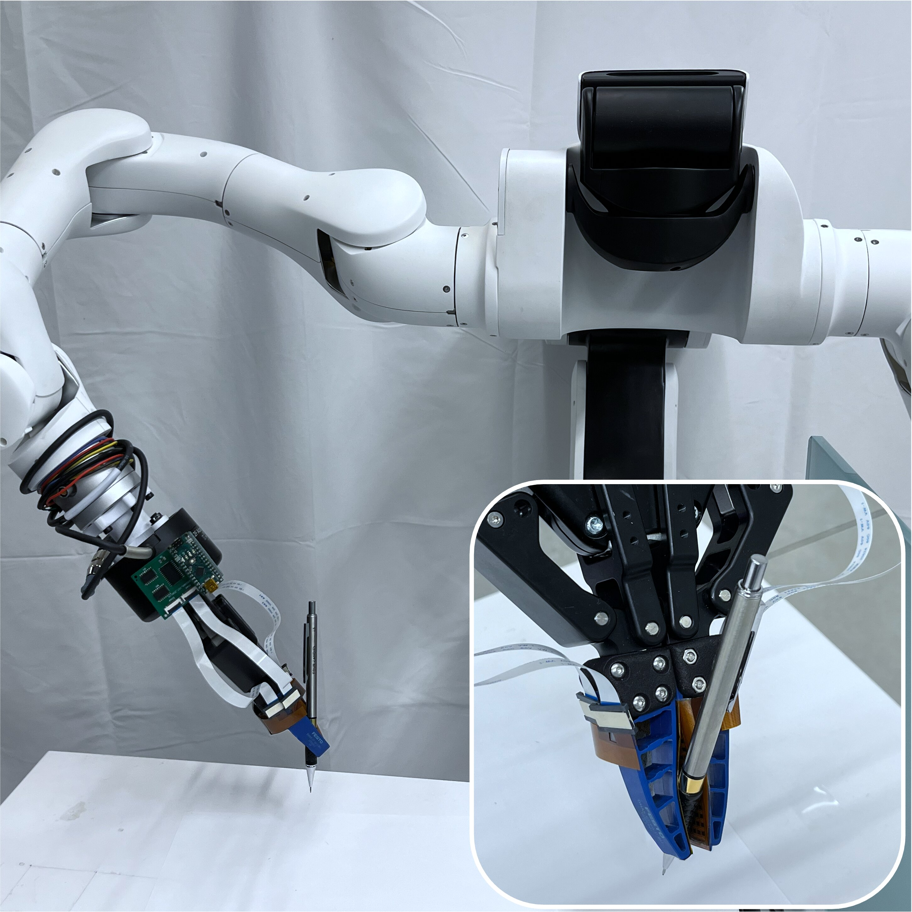
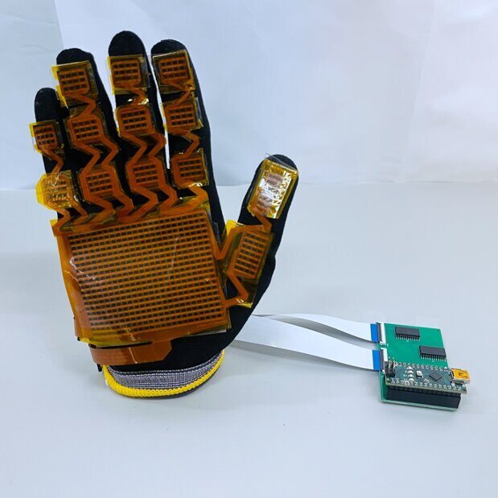

Start here once your sensor shows a live heatmap (see [Stream the sensor](/doc/get-started/stream/)). Learning with touch on a real robot has three parts: mount the sensor where contact happens, record demonstrations that include the tactile stream, and train a policy that uses it. Two open pipelines cover all three. The main difference between them is how you collect the demonstrations.

## Mount the sensor {#mount}

FlexiTac has been mounted on many grippers and hands. These builds from the [project page](/#datacollection) are good starting points for your own mount.

<figure><figcaption>Handheld visuo-tactile gripper (Touch in the Wild)</figcaption></figure>
<figure><figcaption>SO-100/101 arm in LeRobot (LeFlexiTac)</figcaption></figure>
<figure><figcaption>xArm gripper</figcaption></figure>
<figure><figcaption>Franka + tactile skin</figcaption></figure>
<figure><figcaption>Robotiq gripper</figcaption></figure>
<figure><figcaption>Tactile glove</figcaption></figure>

:::tip[Mounting tips]
Mount the sensor on a slightly compliant surface, such as the soft fin-ray fingers in the photos, so contact spreads over several taxels. Route the FFC cables so they don't flex at the connector while the gripper moves, and **calibrate after mounting**, because the mount itself changes the resting baseline.
:::

## Choose a pipeline {#choose}

| | LeFlexiTac | Touch in the Wild |
| --- | --- | --- |
| **How you collect demonstrations** | Teleoperate a robot: SO-100/101 leader and follower arms in LeRobot | By hand, anywhere: a handheld gripper, no robot needed |
| **Sensors** | One 12 × 32 FlexiTac pad on a 3D-printed jaw | Two 12 × 32 pads, one on each soft finger |
| **Reads the sensor with** | PyFlexiTac, with the firmware from these docs | Its own readers (ROS 2 for recording), which expect older text-format firmware |
| **Policies** | ACT, Diffusion Policy, Pi0.5 and SmolVLA, each with or without touch | Diffusion Policy with a pretrained visuo-tactile encoder |
| **Runs the policy on** | The same SO-100/101 arm | A uFactory xArm 850 |
| **Shared data** | You record your own | 2,700+ demonstrations from 43 tasks, plus the pretrained encoder |

**New to robot learning?** Start with LeFlexiTac. It is the lowest-cost setup, uses the sensor exactly as these docs set it up, and covers recording, training and evaluation in one toolchain. Choose **Touch in the Wild** when you want a lot of varied data from outside the lab, or want to build on its released dataset and encoder.

## LeFlexiTac: touch for LeRobot {#leflexitac}

[LeFlexiTac](https://tna001-ai.github.io/LeFlexiTac/) adds FlexiTac to [LeRobot](https://github.com/huggingface/lerobot) on the low-cost SO-100/101 arm (LeFlexiTac calls the family SO10X). A 3D-printed jaw carries one FlexiTac pad, and the tactile map is recorded next to the camera and joint states in a standard LeRobot dataset. Four policy families take it as an extra input, switched on with `--policy.use_tactile=true`. On tube insertion, peg-in-hole and pen retrieval from a bag, the tactile policies beat their vision-only versions in every reported comparison ([results](https://tna001-ai.github.io/LeFlexiTac/#results)).

**You need:** an SO-100/101 leader and follower arm pair, the printed tactile jaw, one working FlexiTac sensor with its reading board, one camera, and a Linux machine with a CUDA GPU for training. Fine-tuning Pi0.5 needs a GPU with at least 80 GB of memory.

:::steps
#### Build the arm and the tactile gripper
Assemble the arms from the [SO-ARM100 guide](https://github.com/TheRobotStudio/SO-ARM100), then print the tactile Moving Jaw and Wrist Roll and fit them. [LeFlexiTac docs: Hardware](https://tna001-ai.github.io/LeFlexiTac/docs.html#hardware)

#### Install LeFlexiTac
Install the fork from source in a Python 3.12 environment. `pip install lerobot` gives you upstream LeRobot, which has no tactile support. [README: Environment setup](https://github.com/TNA001-AI/lerobot_tactile#environment-setup)

#### Calibrate the arms and mount the sensor
Calibrate and test teleoperation with [LeRobot's SO-101 walkthrough](https://huggingface.co/docs/lerobot/il_robots), then mount the pad and confirm it with `flexitac-heatmap`. [LeFlexiTac docs: steps 02–07](https://tna001-ai.github.io/LeFlexiTac/docs.html#reproduction)

#### Record demonstrations
Record with `lerobot-record` and the `so_tactile_follower` robot type, at 30 fps. [LeFlexiTac docs: step 08](https://tna001-ai.github.io/LeFlexiTac/docs.html#reproduction)

#### Train and evaluate
Train with and without touch (`--policy.use_tactile=true` / `false`), then roll the checkpoint out on the arm. Train and run a policy at the same frame rate. [LeFlexiTac docs: steps 09–10](https://tna001-ai.github.io/LeFlexiTac/docs.html#reproduction) · [Practical tips](https://tna001-ai.github.io/LeFlexiTac/docs.html#tips)
:::

## Touch in the Wild: collect anywhere {#touch-in-the-wild}

[Touch in the Wild](https://binghao-huang.github.io/touch_in_the_wild/) (NeurIPS 2025) puts a 12 × 32 FlexiTac pad on each soft finger of a handheld, UMI-style gripper with a GoPro camera. You carry it and do the task yourself, indoors or outdoors, with no robot. With it the authors collected more than 2,700 demonstrations across 43 tasks in 12 environments. That data pretrains a visuo-tactile encoder, which then conditions a Diffusion Policy that runs on an xArm 850 with the same fingers and sensors.

**You need:** the [UMI](https://github.com/real-stanford/universal_manipulation_interface) handheld gripper with Touch in the Wild's modifications and a GoPro Hero 9, two FlexiTac pads with a reading board each, a laptop with Ubuntu 22.04 and ROS 2 Humble for recording, and an NVIDIA GPU for training. To run policies, you need a uFactory xArm 850 with the xArm Gripper, the printed finger holder and GoPro mount from the gripper guide, and an HDMI capture card for the GoPro feed. The full released dataset is large: the pretraining set alone is about 88 GB.

:::steps
#### Build the gripper
Build the UMI gripper, then apply Touch in the Wild's top plate and finger holders and add the two pads. [Gripper guide](https://docs.google.com/document/d/1Gxd2PzVo-sH_XbvnVw_r3eI5i3I3t0rr7JdhpN1PJMA/edit?tab=t.0#heading=h.dcjpnwh7wh40)

#### Set up the recording laptop
Give each reading board a fixed device name, then install the ROS 2 tactile packages. [Data collection: device names](https://github.com/XinyueZhuXY/touch_in_the_wild-data-collection#udev) · [ROS 2 setup](https://github.com/XinyueZhuXY/touch_in_the_wild-data-collection#ros)

#### Collect demonstrations
Record the tactile streams with ROS 2 while the GoPro films. A QR code shown to the camera before each demonstration lines up video and touch. [Data collection protocol](https://github.com/XinyueZhuXY/touch_in_the_wild-data-collection#protocol)

#### Turn the recordings into a dataset
Run the SLAM pipeline on the session folder to get a training dataset. [README: SLAM pipeline](https://github.com/XinyueZhuXY/touch_in_the_wild#creating-a-dataset-with-the-slam-pipeline)

#### Pretrain the encoder, or download it
Pretrain the visuo-tactile encoder on your data or the [released dataset](https://huggingface.co/datasets/binghaohuang-robot/touch_in_the_wild-dataset), or start from the [pretrained checkpoint](https://huggingface.co/xinyue-zhu/pretrained_mae). [README: Pretraining](https://github.com/XinyueZhuXY/touch_in_the_wild#%E2%80%8Dpretraining-the-visuotactile-mae) · [Evaluate a checkpoint](https://github.com/XinyueZhuXY/touch_in_the_wild#evaluate-a-checkpoint)

#### Train and run the policy
Train the tactile Diffusion Policy, then run it on the xArm 850. [README: Training](https://github.com/XinyueZhuXY/touch_in_the_wild#training-diffusionpolicies) · [Real-world deployment](https://github.com/XinyueZhuXY/touch_in_the_wild#realworld-deployment)
:::

:::caution[It needs different firmware]
Touch in the Wild reads the boards with its own code, not PyFlexiTac: a ROS 2 node while recording, and serial readers when running a policy. Both expect the older **text** output, 16 lines of 32 numbers per frame. The firmware in [Stream the sensor](/doc/get-started/stream/#flash) sends **binary** frames instead, so a board flashed from these docs won't work with Touch in the Wild as it is, and its repositories don't include matching firmware. Ask in its [issues](https://github.com/XinyueZhuXY/touch_in_the_wild/issues) or on the [Discord](https://discord.gg/6gw887Vxms) before you build.
:::

## Research background {#research}

[3D-ViTac](https://binghao-huang.github.io/3D-ViTac/) (CoRL 2024) is where this line of work started. It introduced the sensor now called FlexiTac-V1 and the *visuo-tactile point cloud*, which places each taxel in 3D next to the camera points and feeds both to one policy. For now its [training-code repository](https://github.com/binghao-huang/3d-vitac-training-code) only points to the pre-training stage of [VT-Refine](/doc/simulation/#vt-refine). The authors say that stage uses the same setup but runs in simulation, on VT-Refine's plug–socket data rather than 3D-ViTac's own tasks. 3D-ViTac's data and real-robot code have not been released yet.

For more work built on FlexiTac, see [Awesome FlexiTac](https://binghao-huang.github.io/Awesome-FlexiTac/). If a step in a project's guide doesn't work, open an issue in that project's repository.
