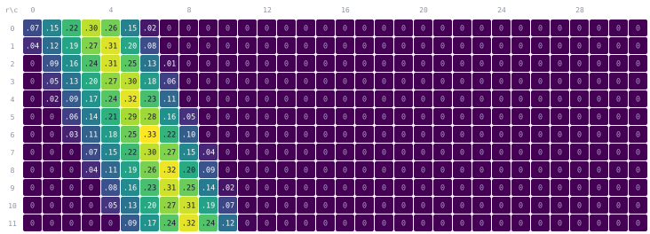
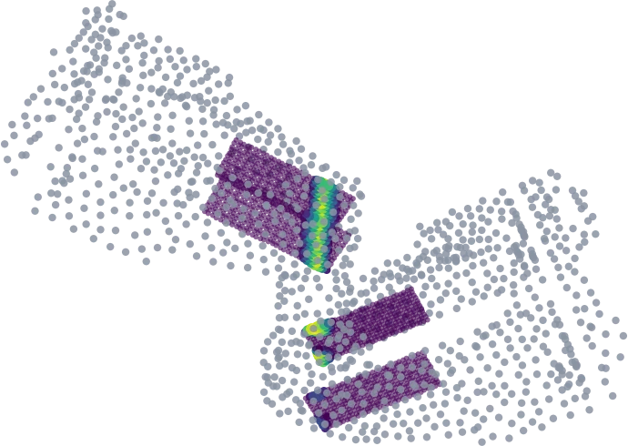
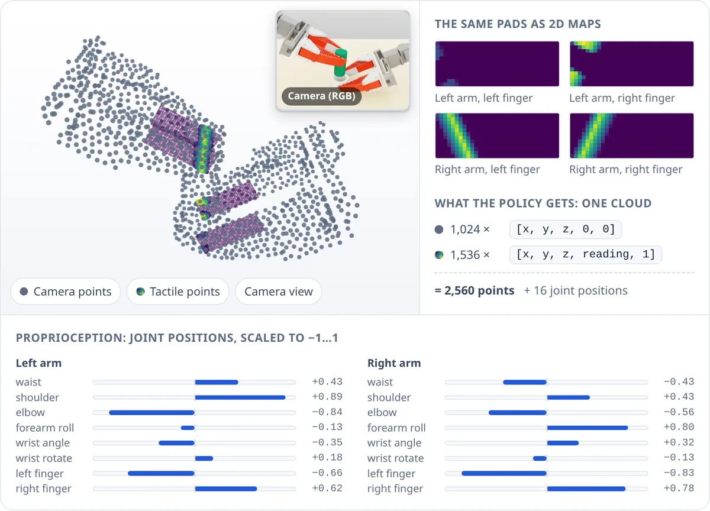

Every FlexiTac frame is a grid of numbers, one per taxel: 12 rows by 32 columns on a standard sensor ([why 12 × 32 and not 32 × 12](/doc/get-started/#array-shape)). Before a policy can learn from it, you choose how to represent it. There are two ways, and the difference is whether touch knows *where* it happens.

<div class="rep2">
<div class="rep2-card">
<a class="rep2-img" href="#2d"></a>
<a class="rep2-h" href="#2d">2D tactile maps</a>
<i>Local contact patterns</i>
<p>A fixed sensor layout, CNN encoders, and the easiest way into imitation learning.</p>
<dl>
<dt>Policy gets</dt><dd>One 12 × 32 map per pad</dd>
<dt>Encoder</dt><dd>MLP or small CNN</dd>
<dt>Used by</dt><dd><a href="https://tna001-ai.github.io/LeFlexiTac/" target="_blank" rel="noopener">LeFlexiTac</a>, <a href="https://binghao-huang.github.io/touch_in_the_wild/" target="_blank" rel="noopener">Touch in the Wild</a></dd>
</dl>
</div>
<div class="rep2-card">
<a class="rep2-img" href="#3d"></a>
<a class="rep2-h" href="#3d">3D tactile points</a>
<i>Spatially grounded contact</i>
<p>Geometric reasoning, visuo-tactile fusion, and manipulation across poses.</p>
<dl>
<dt>Policy gets</dt><dd>One 3D point per taxel</dd>
<dt>Encoder</dt><dd>PointNet or similar</dd>
<dt>Used by</dt><dd><a href="https://binghao-huang.github.io/3D-ViTac/" target="_blank" rel="noopener">3D-ViTac</a>, <a href="https://binghao-huang.github.io/vt_refine/" target="_blank" rel="noopener">VT-Refine</a></dd>
</dl>
</div>
</div>
<p class="rep2-note">A conceptual guide. Which works better for your task still has to be tested on it.</p>

## 2D: a map per pad {#2d}

The firmware sends each frame as `uint8[12][32]`, row by row ([PyFlexiTac](/doc/get-started/pyflexitac/#python)). Subtract each taxel's resting baseline and scale, and every reading lies between 0 and 1. Keep the numbers on their grid, colour them by value, and the array is an image:

<figure class="figure tmap"><figcaption><span class="sample-tag">Simulated</span>One pad at one moment: 384 readings on its 12 × 32 grid (row, column). The pressed taxels form a band where the plug lies across the pad. From the simulated demonstration below (right arm, left finger), at the same moment as its 3D view; the simulator reports force divided by 10 N.</figcaption></figure>

A policy can take the map in two ways:

- **As a vector.** Flatten the 384 readings into one list and feed it to an MLP. It's the simplest input, but the network has to learn which taxels are neighbours.
- **As an image.** Keep the grid and use a small CNN, as for a one-channel camera image, so a contact's shape looks the same wherever it falls on the pad. LeFlexiTac does this: three 3 × 3 convolution layers with pooling turn each map into 256 features, which become extra tokens for ACT, or part of Diffusion Policy's conditioning ([encoder](https://github.com/TNA001-AI/lerobot_tactile/blob/6e59779ac4a711155474477e7ab6997d7160ead0/src/lerobot/policies/tactile/encoder.py)). Touch in the Wild treats touch as images too: its pre-training learns to rebuild masked tactile images from the camera image.

Settle two things before you record:

- **How you normalize.** PyFlexiTac's `normalized` divides each frame by its own peak once there is contact, so it keeps the shape of a contact but not how hard it is ([details](/doc/get-started/pyflexitac/#normalized)). LeFlexiTac records these maps, and VT-Refine uses the same kind of rule: each pad is scaled by its own peak once it is pressed. If force matters, record `raw` and the baseline too. Either way, normalize the same way in training and on the robot.
- **Which pad is which.** Keep the pads in a fixed order and orientation. Touch in the Wild stores its two pads side by side, as one 12 × 64 map per frame.

**A map doesn't say where the pad is.** The same line of contact means something different when the gripper is turned or the object is higher. Given the joint angles and the pad's fixed mounting, a policy can still infer where the contact is, but it has to learn that from data. 3D tactile points put it in the data.

## 3D: tactile points {#3d}

[3D-ViTac](https://binghao-huang.github.io/3D-ViTac/) (CoRL 2024) puts every taxel in the same 3D frame as the camera's points, so fingers, contacts and objects share one point cloud. [VT-Refine](https://binghao-huang.github.io/vt_refine/) (CoRL 2025) does the same on the two-armed ALOHA robot. The viewer shows one plug–socket demonstration from [FlexiTac's Isaac Sim simulation](/doc/simulation/#isaac-sim), with a pad on each of ALOHA's four fingers.

<div class="pcv" data-sample="/doc/assets/data/isaac-aloha" data-frame="94" data-label="One frame of a simulated plug–socket insertion as a point cloud: the camera's points and the four pads' tactile points" data-pads="Left arm, left finger|Left arm, right finger|Right arm, left finger|Right arm, right finger" data-joints="Left arm: waist|Left arm: shoulder|Left arm: elbow|Left arm: forearm roll|Left arm: wrist angle|Left arm: wrist rotate|Left arm: left finger|Left arm: right finger|Right arm: waist|Right arm: shoulder|Right arm: elbow|Right arm: forearm roll|Right arm: wrist angle|Right arm: wrist rotate|Right arm: left finger|Right arm: right finger" data-joints-title="Proprioception: joint positions, scaled to −1…1"></div>
<script src="/doc/assets/pcv.js?v=20261126b" defer></script>
<p class="pcv-cap"><span class="sample-tag">Simulated</span>The right arm holds the plug over the socket in the left hand. <b>Inset:</b> the camera's picture. <b>Grey:</b> the points the same camera sees, 1,024 of them here so they read clearly (VT-Refine keeps 512). <b>Purple to yellow:</b> the four pads' 1,536 tactile points, colored by reading on the viridis scale (purple where nothing presses). On the right, the same readings as 2D maps; below, the joint positions the policy also gets. Drag to turn it, <b>Camera view</b> goes back to the camera, and play runs the demonstration at its recorded 30 frames a second.</p>

### How a frame is built {#build}

:::steps
#### Proprioception
Read the 16 joint positions of both arms and grippers: per arm, 6 joints and 2 fingers. They do two jobs. Forward kinematics turns them into each pad's pose, which the next step needs, and they go to the policy as an input of their own, through a small MLP. (That is the design in both papers. VT-Refine's released ALOHA config leaves this input out and uses the cloud alone.)

#### Tactile points
Each taxel has a fixed spot on its pad: a 12 × 32 grid, 2 mm apart. Moving the grid by its pad's pose puts every taxel in the table's frame (its origin is the centre of the table). Each tactile point carries its reading. Untouched taxels stay, with a reading of 0, so there are always 4 × 384 = 1,536 of them, and they also show where the fingers are.

#### Camera points
The depth camera's image becomes 3D points in the same table frame. Points outside a box around the workspace are dropped, and 512 of the rest are kept. They carry no colour.

#### One point cloud
Both sets go into one cloud of 2,048 points. Each point has five numbers: x, y, z, the reading (0 for camera points), and a flag that tells the two kinds apart (0 for the camera, 1 for touch).

#### Encoder and policy
A PointNet runs the same small network on every point, then keeps the maximum of each feature over all points, so the order of the points doesn't matter. With the joint features, the result conditions a Diffusion Policy. In VT-Refine it sees the last two frames, predicts the next 16 steps of target joint positions, runs 8 of them, then looks again. 3D-ViTac uses PointNet++.
:::

### In simulation {#sim}

VT-Refine builds the same observation in simulation, so a policy trained on real demonstrations can keep training there with reinforcement learning. The taxel grid is laid on each simulated pad, the physics engine gives the pad's pose, and each reading comes from how far the taxel presses into the object, normalized with the same rule as the real pads. Noise is added to the simulated camera points only. See [Tactile simulation](/doc/simulation/#vt-refine).

The viewer above comes from FlexiTac's Isaac Sim simulation in the same way. Its tactile sensors give each taxel's position and reading directly. The picture and the camera points come from the simulated camera's color and depth images, so the cloud has no sensor noise, and the table is cropped away just above its surface, as on a real robot ([recording script](https://github.com/FlexiTac/FlexiTac.github.io/blob/main/doc/_src/tools/isaac_sample.py)).

## The data {#data}

VT-Refine's pre-training data, its real-robot demonstrations, stores every step as plain arrays. For the ALOHA tasks:

| Array | Shape per step | What it holds |
| --- | --- | --- |
| `point_cloud` | 3 × 512 | Camera points: x, y, z in metres, in the table's frame |
| `tactile_points` | 4 × 1,536 | The four pads' 384 taxels each: x, y, z and the reading (0 to 1, each pad scaled by its own peak) |
| `joint_states` | 16 | Joint positions: per arm, 6 joints and 2 fingers, left arm first, scaled to −1…1 |
| `actions` | 16 | Target joint positions, in the same order and scale |
| `traj_lengths` | one per demonstration | Its number of steps, to split the arrays into demonstrations |

The pads are in the order left arm left finger, left arm right finger, right arm left finger, right arm right finger. `normalization.pth`, next to each `train.npz`, holds the ranges to turn joint values and actions back into radians and metres.

To get the 2D maps back from this data, or to build the five-channel cloud yourself:

```python
import numpy as np

d = np.load("train.npz")                    # plain arrays; no pickle needed
t = 0                                        # a step: any index below len(d["actions"])
pc, tac = d["point_cloud"][t], d["tactile_points"][t]   # (3, 512), (4, 1536)

# 2D: each pad's 384 points are stored column by column
maps = tac[3].reshape(4, 32, 12).transpose(0, 2, 1)       # (4, 12, 32)

# 3D: x, y, z, reading, flag
cloud = np.concatenate([
    np.vstack([pc,  np.zeros((2, 512))]),    # camera points: reading 0, flag 0
    np.vstack([tac, np.ones((1, 1536))]),    # tactile points: reading, flag 1
], axis=1)                                   # (5, 2048)
```

The data is about 909 MB, under CC BY-NC 4.0. Download it with `data/fetch_vt-refine_data.sh` from the [VT-Refine repository](https://github.com/NVlabs/vt-refine).

## Next {#next}

:::cards
#### Train with 2D tactile maps | /doc/robot-learning/imitation-learning/#leflexitac | grid
LeFlexiTac: ACT and Diffusion Policy, with a small CNN on each map.

#### Train with 3D tactile points | /doc/simulation/#vt-refine | layers
VT-Refine, and 3D-ViTac's [training code](https://github.com/binghao-huang/3d-vitac-training-code).

#### Learn tactile features from large datasets | /doc/robot-learning/pretraining/ | net
Touch in the Wild's visuo-tactile MAE, pretrained on its released data.
:::
